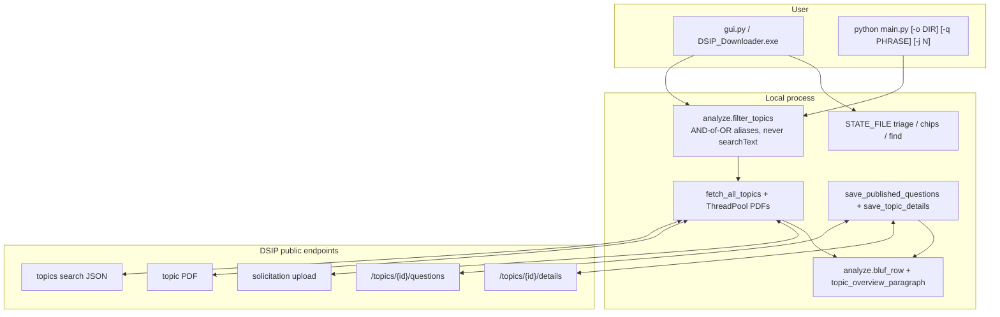
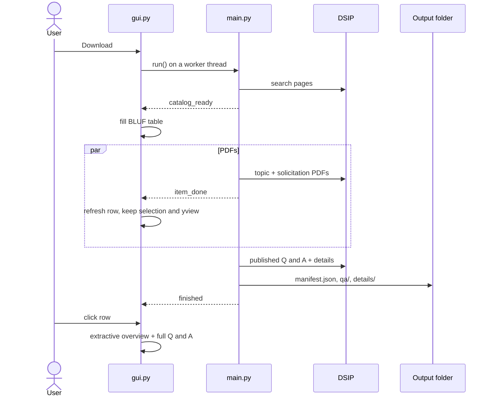
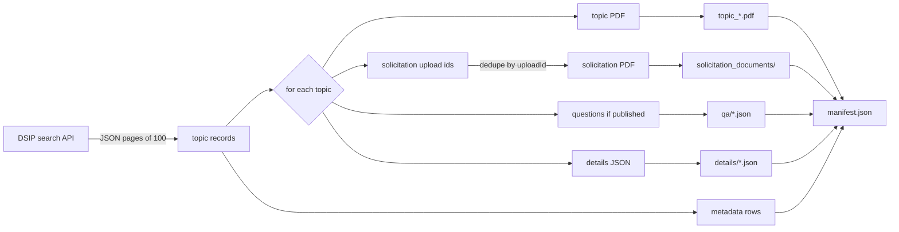

# Current architecture

Diagrams, data paths, and design notes for
[Gov-SBIR-Opportunities-Puller-Evaluator](README.md). Start with the README
if you only need to run the tool.

This is a **local DSIP open-topics appliance**. Polar = snapshot depth.
Evaluator = no CRM, no third-party OAuth, no cloud LLM, no public unsigned
`.exe`, no DSIP `searchText`, no scrape of navysbir.com / GovWin / SLED.

Decision records live in [`docs/design-decisions/`](docs/design-decisions/).

## What a run writes

```text
all_dsip_opportunities_YYYYMMDD_HHMMSS/
  manifest.json
  topic_{code}_{title}.pdf
  solicitation_documents/
    {preface or component instruction}.pdf
  qa/
    {code}.json          # published Topic Q&A only
  details/
    {code}.json          # keywords, tech areas, ITAR, objective
```

`~/.dsip_downloader_state.json` is **machine-local**: parent folder, last
snapshot path, Pursue/Watch/Pass + notes, chips, Find, call filter, tech
area. It is never written into the download folder and must not be committed.

## Desktop + CLI



## Catalog-first GUI



## CLI data flow



## Filter algebra

User text (download filter, chips that are not `__*`, Find) is **never** sent
to DSIP. `analyze.query_groups` expands each token to an OR-group
(`DAF` → daf / usaf / air force). Groups are ANDed. Code prefixes
(`^([A-Za-z]{2,4})`) and word-boundary matches for tokens of length ≤ 3 stop
`AI` from hitting `Domain`. Cosine similarity is display-only; it is not a
keep/drop gate.

Workflow chips `__open__`, `__qa__`, `__itar__`, `__new__`, `__changed__`,
`__due7__`, `__due14__` never enter the download phrase.

## Topic overview (not a model)

`topic_overview_paragraph` reads `details/*.json` objective/description and
the local PDF (bounded `pypdf`), strips ITAR boilerplate, and keeps the first
usable sentences, cut on a sentence boundary. If `pypdf` is missing, details
JSON still fills the paragraph. A later **opt-in local** Ollama/llama.cpp
query path is recorded in
[ADR 010](docs/design-decisions/010-optional-local-llms.md) and is not landed.

## Concurrency

Downloads are network/disk bound. `ThreadPoolExecutor` default is
`cpu_count * 5`, floored at 4 and capped at 64. Catalog paging is sequential.
Q&A and details are best-effort sequential after PDFs.

## Topic PDF vs solicitation PDF

- **Topic PDF** — one problem sheet per row (`/topics/{id}/download/PDF`).
- **Solicitation / instruction PDF** — shared BAA/CSO rulebook in
  `solicitation_documents/`. The Topic pane **Open instruction PDF** button
  opens the first path listed on that row, still sandboxed by `resolve_pdf`.

## Release cadence (FY27 snapshot)

DoW is on a monthly FY27 calendar. The How-SBIR-works tab copies that table
as a **dated snapshot** (Navy SBIR page, 28 Sep 2026). Confirm on
[DSIP Topics](https://www.dodsbirsttr.mil/topics-app/). This repo does not
scrape navysbir.com.

| FY27 release | Pre-release | Opens | Closes |
| --- | --- | --- | --- |
| 1 | 7 Oct 2026 | 28 Oct 2026 | 25 Nov 2026 |
| 2 | 4 Nov 2026 | 2 Dec 2026 | 6 Jan 2027 |
| 3 | 2 Dec 2026 | 6 Jan 2027 | 3 Feb 2027 |
| 4 | 6 Jan 2027 | 27 Jan 2027 | 24 Feb 2027 |
| 5 | 3 Feb 2027 | 24 Feb 2027 | 24 Mar 2027 |
| 6 | 3 Mar 2027 | 24 Mar 2027 | 21 Apr 2027 |
| 7 | 7 Apr 2027 | 28 Apr 2027 | 26 May 2027 |
| 8 | 5 May 2027 | 26 May 2027 | 23 Jun 2027 |
| 9 | 2 Jun 2027 | 23 Jun 2027 | 21 Jul 2027 |
| 10 | 7 Jul 2027 | 28 Jul 2027 | 25 Aug 2027 |
| 11 | 4 Aug 2027 | 25 Aug 2027 | 22 Sep 2027 |
| 12 | 1 Sep 2027 | 22 Sep 2027 | 20 Oct 2027 |

## Notebook map

`DSIP_portal_ai_query_tool.ipynb` is the research log that found the public
search API. `main.py` does not use it. Notebook browser cells need Playwright
and a key only for the unused chatbot cell.

## Residual product rules

- Open topics only (`solicitationCycleNames: ["openTopics"]`).
- Public routes can change; constants sit at the top of `main.py`.
- Exit `0` = catalog count matches `total` and PDFs saved or already valid.
- Exit `1` = short catalog or a failed file. Exit `130` = interrupt; resume
  with the same `--output`.

See [implementation-recommendations.md](docs/implementation-recommendations.md)
for what is still later.
