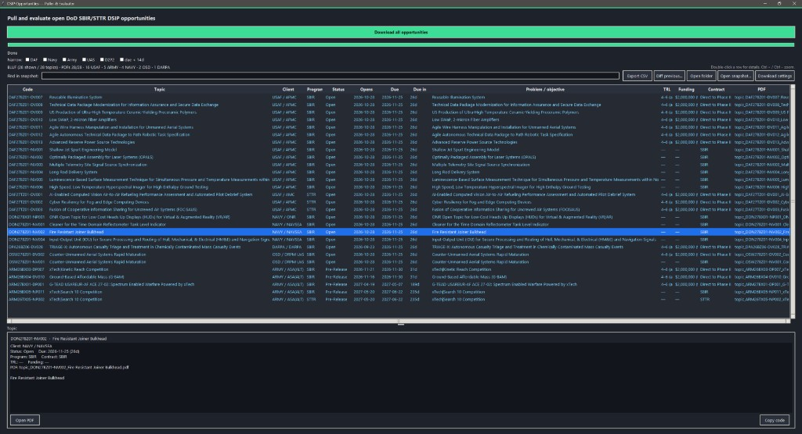

# Gov SBIR Opportunities Puller & Evaluator

A local desktop tool that downloads the current public
[DoD SBIR/STTR DSIP open-topics catalog](https://www.dodsbirsttr.mil/topics-app/)
onto your machine: one topic PDF per row, the shared solicitation /
instruction PDFs, published Topic Q&A, topic details, and a `manifest.json`.

Use it to triage Air Force, Army, Navy, OSD, DARPA, and other DoW topics
without a GovWin / HigherGov / GovTribe seat. Nothing you type is sent to
DSIP as `searchText`. There is no cloud AI and no login.

Architecture diagrams and design notes:
[CURRENT_ARCHITECTURE_README.md](CURRENT_ARCHITECTURE_README.md).

## Run it (Windows, from source)

You need **Python 3.14** in the `dsip-opportunities` conda environment.

```bat
cd /d C:\Users\zdorg\code_dev\Gov-SBIR-Opportunities-Puller-Evaluator
call "%UserProfile%\miniconda3\condabin\conda.bat" activate dsip-opportunities
pip install -r requirements.txt
python gui.py
```

If conda is not installed yet, use the official Miniconda installer
<https://www.anaconda.com/docs/getting-started/miniconda/install> and create
the env once:

```bat
conda create -n dsip-opportunities python=3.14 -y
call "%UserProfile%\miniconda3\condabin\conda.bat" activate dsip-opportunities
pip install -r requirements.txt
```

macOS / Linux: same conda env, then `python gui.py` or `python main.py`.
There is no packaged `.exe` for those platforms.

## First session

1. Pick a **Save in folder** (defaults to Downloads).
2. Leave **Download filter** blank to pull every open topic, or type a local
   phrase such as `DAF UAS` (aliases stay on this machine).
3. Click **Download all opportunities**.
4. The table fills as soon as the catalog lands. Settings collapse when the
   run finishes so the table and Topic pane own the window.
5. Click a row. The bottom pane shows an extractive overview of that topic
   PDF, published Q&A, CMMC / ITAR, and actions.



Useful keys and chips

- **Component** chips match DSIP groups (DAF, Army, Navy, …). Counts appear
  after a snapshot is loaded; empty groups hide unless you show them.
- **Narrow:** SBIR / STTR / UAS / D2P2 / Open / Has Q&A / ITAR / New /
  Changed / due windows. **New** and **Changed** fill after
  **Diff previous…**.
- **Find in snapshot** (Ctrl+F) filters the table you already have.
- `1` Pursue · `2` Watch · `3` Pass · `0` clear (table focused).
- **Copy brief** (Ctrl+B) copies a one-block capture note.
- **Open PDF** / **Open instruction PDF** open files already in the snapshot
  folder. Paths cannot leave that folder.
- **How SBIR works** is an offline briefing plus a dated FY27 calendar.
  Confirm deadlines on DSIP.

Calls and notes live in `~/.dsip_downloader_state.json` on this computer
only. They are not written into `manifest.json`.

## Command line

```bat
python main.py
python main.py --output D:\dsip_pulls\october
python main.py --query "DAF UAS"
python main.py --workers 16
```

The phrase after `--query` is applied locally after the catalog download. A
relative `--output` is created if needed. Valid PDFs already in that folder
are skipped, so a second run resumes.

## What a download looks like

```text
all_dsip_opportunities_YYYYMMDD_HHMMSS/
  manifest.json
  topic_DAF27BZ01-DV007_Reusable Illumination System.pdf
  solicitation_documents/
    DoW 2027 SBIR BAA Preface_....pdf
  qa/
  details/
```


- **Topic PDF** — the problem sheet for one row.
- **solicitation_documents/** — shared BAA / component instructions.
- **qa/** — published Topic Q&A (read-only; asking still needs a DSIP login).
- **details/** — keywords, technology areas, ITAR, objective.

Optional `pypdf` (`pip install pypdf`) fills TRL / funding / the overview
paragraph from the local PDF. Without it, catalog columns still work.

## Build the Windows `.exe` yourself

A prebuilt public download is **not** offered. Unsigned PyInstaller binaries
are often misflagged, so GitHub Actions keeps the build as a **workflow
artifact** for the repo owner. To build locally:

```bat
call conda activate dsip-opportunities
pip install -r requirements-build.txt
pyinstaller --noconfirm --clean DSIP_Downloader.spec
```

Then run `dist\DSIP_Downloader.exe`. The first launch of an unsigned build
may show SmartScreen: **More info → Run anyway**.

Windows 10/11 64-bit only. Smoke test: `dist\DSIP_Downloader.exe --selftest`.

## Tests

```bat
call conda activate dsip-opportunities
pytest
```

## FY27 cadence (confirm on DSIP)

DoW is on a monthly FY 2027 calendar. Release 1 closes **25 Nov 2026**.
Release 2 pre-releases **4 Nov 2026**. The full dated table is in
[CURRENT_ARCHITECTURE_README.md](CURRENT_ARCHITECTURE_README.md) and on the
How-SBIR-works tab. This app does not scrape navysbir.com.

## License

[PolyForm Noncommercial License 1.0.0](LICENSE). Personal and other
noncommercial use only. Downloaded government PDFs are public U.S.
Government documents and are not covered by that license.
