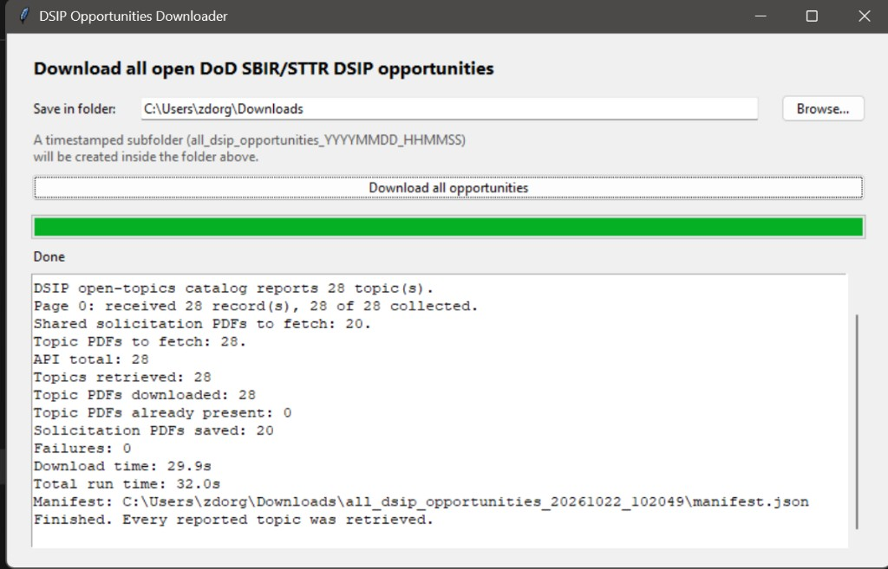
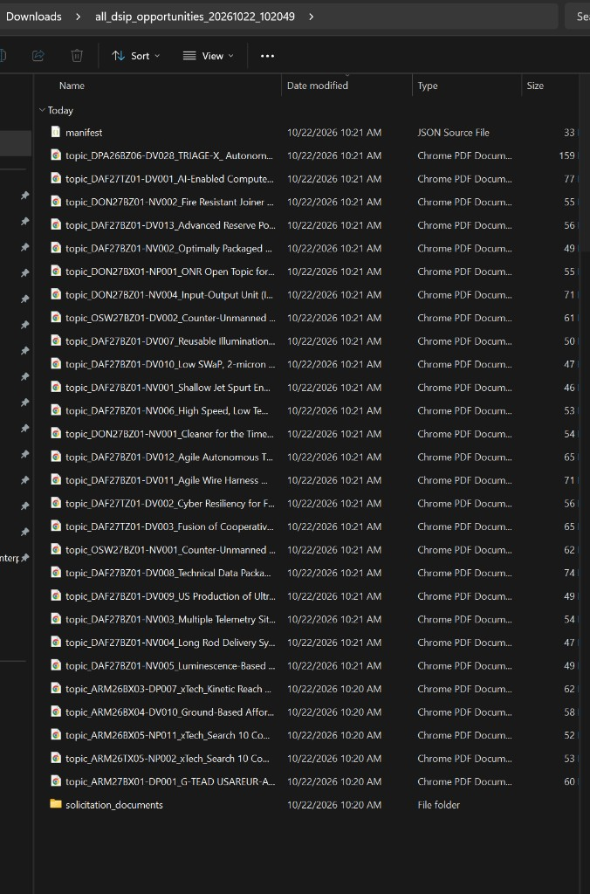
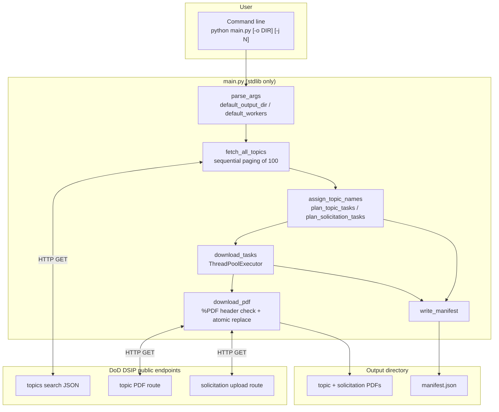
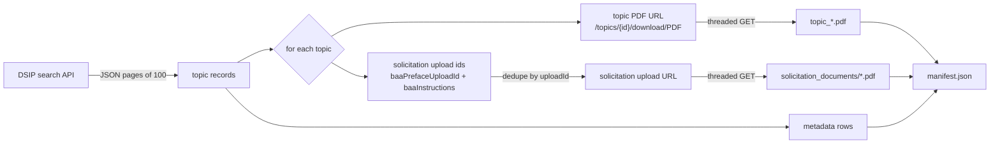
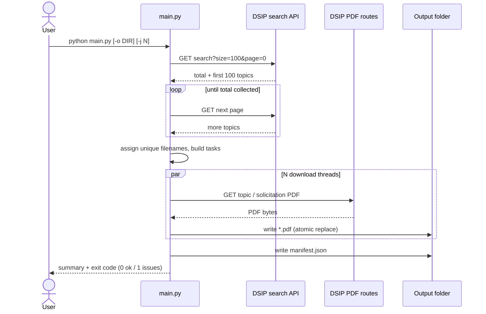

# Gov SBIR Opportunities Puller

Downloads the current public [DoD SBIR/STTR DSIP topics catalog](https://www.dodsbirsttr.mil/topics-app/) to disk: one topic-detail PDF per topic, the shared solicitation PDFs attached to those topics, and a `manifest.json` that lists every record the API returned. Downloads run concurrently on a thread pool.

`main.py` is the command-line script to run, and `gui.py` is a one-click desktop app built on top of it; both use only the Python standard library. The app can also be packaged into a standalone Windows `.exe` (see [Building the Windows executable](#building-the-windows-executable)). `DSIP_portal_ai_query_tool.ipynb` is the Colab notebook that found the DSIP search API and the download buttons; it is kept as the research log.

## What it looks like

Pick a folder, click one button, and watch the download complete. The app reports live progress, a per-run summary (counts plus download and total run time), and where everything was saved:



Every open topic is saved as its own PDF in a timestamped folder, alongside a `manifest.json` and a `solicitation_documents/` subfolder of the shared solicitation PDFs:



## Download for Windows (no Python needed)

The easiest way to use this tool is the prebuilt Windows app. **You do not need Python or anything else installed** — the Python runtime, Tkinter, and every dependency are bundled inside one file. There is nothing to install.

> ### [⬇ Download DSIP_Downloader.exe](https://github.com/gzdor/Gov-SBIR-Opportunities-Puller-Evaluator/releases/download/latest/DSIP_Downloader.exe)
>
> Single file, ~14 MB. From the **Latest Windows build** release.

Prefer the command line? Download it with one command in PowerShell:

```powershell
curl.exe -L -o "$env:USERPROFILE\Downloads\DSIP_Downloader.exe" https://github.com/gzdor/Gov-SBIR-Opportunities-Puller-Evaluator/releases/download/latest/DSIP_Downloader.exe
```

You can also browse every build on the [Releases page](https://github.com/gzdor/Gov-SBIR-Opportunities-Puller-Evaluator/releases).

### Compatibility (Windows only)

| Requirement | Supported |
| --- | --- |
| Operating system | **Windows 10** or **Windows 11** |
| Architecture | **64-bit (x64) only** |
| Install needed | **None** — a single portable `.exe` |
| macOS / Linux | **Not supported** |

This executable is **Windows only**. It will **not** run on macOS, Linux, 32-bit Windows, or Windows 7/8. (macOS support is not currently planned; Mac users can still run `gui.py` or `main.py` from source — see below.)

### How to run it

There is no installer — it is a single, self-contained file.

1. Download `DSIP_Downloader.exe` using the link or command above.
2. Double-click the file to open the app.
3. The first launch may show a blue **"Windows protected your PC"** SmartScreen prompt, because the app is not code-signed. Click **More info → Run anyway**. This warning is normal for free, unsigned apps; this `.exe` is built automatically from the source in this repository.
4. Pick a folder to save into (for example your Downloads folder), click **Download all opportunities**, and watch the progress bar. When it finishes, the app offers to open the folder of PDFs.

## Topic PDFs vs. solicitation documents

The downloader saves two kinds of PDF, which play different roles. Understanding the distinction makes the output directory easy to navigate.

### Topic PDFs (one per topic, saved at the top level)

Files like `topic_DAF27BZ01-DV007_Reusable Illumination System.pdf`.

- **One per topic.** A "topic" is a single, specific research problem an agency wants solved (e.g. "Low SWaP, 2-micron Fiber Amplifiers"). Each row in the DSIP open-topics list is one topic.
- The PDF is the **topic-detail sheet**: topic code, title, objective, description, phases, technical requirements, references, and the Q&A / point-of-contact info for *that one topic*. It is what you read to decide whether to propose.
- This is the file behind **"Download Topic Details as: PDF"** on each DSIP row, fetched from `/topics/api/public/topics/{topicId}/download/PDF`.

### Solicitation documents (one per solicitation, saved in `solicitation_documents/`)

Files like `ARMY_SBIR_27BX_R1_v2.pdf` or `DoW 2027 SBIR BAA Preface_10072026.pdf`.

- **One per solicitation / BAA, shared across many topics.** A "solicitation" (or BAA/CSO) is the umbrella funding announcement that a whole *batch* of topics belongs to. For example, all the `DAF27BZ01-*` topics live under the same DAF solicitation.
- These PDFs hold the **program-wide rules**: eligibility, proposal format, deadlines, submission instructions, evaluation criteria, contract terms, firm-size limits, etc. — the legal/administrative boilerplate that applies to every topic in that solicitation.
- Because many topics map to the same solicitation, there are usually far fewer of these than topics. `main.py` de-duplicates them so each shared solicitation PDF is downloaded once, not once per topic.

### The relationship

Think of it as **parent → child**:

```text
Solicitation (BAA)  ──►  the rulebook for applying      (solicitation_documents/)
   └─ Topic          ──►  the specific problem to solve  (topic_*.pdf at top level)
```

To actually submit a proposal you need **both**: the topic PDF tells you *what* to build, and the solicitation PDF tells you *how, when, and by whom* it can be submitted. Each topic's entry in `manifest.json` lists which solicitation it belongs to, so you can trace any `topic_*.pdf` back to its governing document in `solicitation_documents/`.

## Architecture



## Data flow



## User data flow



## Python version

Use **Python 3.14**. The conda environment for this repo is named `dsip-opportunities` and is Python 3.14. `main.py` imports only the standard library, so Python 3.10 or newer can run it; 3.14 is the version to install and the version the environment and tests were verified on.

## Install Miniconda

Skip this when `conda --version` already prints a version. This machine already has Miniconda at `%UserProfile%\miniconda3` (Windows) and `~/miniconda3` (WSL). The one-liners are for a computer that does not have it yet. Both were run with these flags into a temporary folder, checked with `conda --version`, and removed.

The install prefix cannot contain spaces. On Windows, `/D=` has to be the last argument.

Windows Command Prompt:

```bat
curl -fsSL -o "%TEMP%\Miniconda3-latest-Windows-x86_64.exe" https://repo.anaconda.com/miniconda/Miniconda3-latest-Windows-x86_64.exe && start /wait "" "%TEMP%\Miniconda3-latest-Windows-x86_64.exe" /InstallationType=JustMe /AddToPath=0 /RegisterPython=0 /S /D=%UserProfile%\miniconda3 && del "%TEMP%\Miniconda3-latest-Windows-x86_64.exe"
```

Bash:

```bash
curl -fsSL https://repo.anaconda.com/miniconda/Miniconda3-latest-Linux-x86_64.sh -o /tmp/miniconda.sh && bash /tmp/miniconda.sh -b -p "$HOME/miniconda3" && rm /tmp/miniconda.sh
```

The Windows install does not put `conda` on `PATH`. Load it in the same Command Prompt with:

```bat
call "%UserProfile%\miniconda3\condabin\conda.bat"
```

In bash, load it and enter `base` with:

```bash
source "$HOME/miniconda3/etc/profile.d/conda.sh"
conda activate base
```

## Environment

A fresh Miniconda `base` is Python 3.14 already, but create a dedicated environment so this project is isolated. Windows and WSL each have their own Miniconda, so each one gets its own `dsip-opportunities` environment (both Python 3.14.8).

Windows Command Prompt, from the repository root:

```bat
cd /d C:\Users\zdorg\code_dev\Gov-SBIR-Opportunities-Puller-Evaluator
conda create -n dsip-opportunities python=3.14 -y
call "%UserProfile%\miniconda3\condabin\conda.bat" activate dsip-opportunities
python -c "import sys; print(sys.version)"
pip install -r requirements.txt
pytest
python main.py --help
```

WSL bash:

```bash
source "$HOME/miniconda3/etc/profile.d/conda.sh"
conda create -n dsip-opportunities python=3.14 -y
conda activate dsip-opportunities
python -c 'import sys; print(sys.version)'
cd /mnt/c/Users/zdorg/code_dev/Gov-SBIR-Opportunities-Puller-Evaluator
pip install -r requirements.txt
pytest
python main.py --help
```

Both sequences were run end to end. `pip install -r requirements.txt` installs the notebook packages plus pytest (`main.py` itself needs none of them). `pytest` runs the 20 tests in `test/test_main.py`. `python main.py --help` prints the downloader usage. `conda create` stops if the environment name already exists.

## Quick start

With `dsip-opportunities` active, from the repository root:

```bat
python main.py
```

That creates a new folder in this directory named `all_dsip_opportunities_YYYYMMDD_HHMMSS` (local time) and writes the PDFs there.

Choose the folder yourself:

```bat
python main.py --output D:\dsip_pulls\october
```

Set the number of download threads:

```bat
python main.py --workers 16
```

A relative `--output` path is resolved from the current working directory. The folder is created if it does not exist. Files that are already valid PDFs in that folder are left in place, so a second run into the same directory resumes.

## Desktop app (GUI)

For a point-and-click experience there is a small desktop app, `gui.py`, built with Tkinter (which ships with Python, so it adds no third-party runtime dependency). It does exactly three things:

1. **Pick a folder** to save into (defaults to your `Downloads` folder).
2. Click **Download all opportunities**.
3. Watch a **progress bar** fill as the PDFs land, then open the result folder.

The app creates a timestamped `all_dsip_opportunities_YYYYMMDD_HHMMSS` subfolder inside the folder you chose and writes the PDFs and `manifest.json` there — the same layout as the CLI. The download runs on a background thread so the window stays responsive; all the actual work is done by `main.py`, which the GUI drives through its progress-reporter interface (no duplicated logic).

Run it from source:

```bat
python gui.py
```

Non-technical users do not need Python at all — see the packaged `.exe` below.

## Building the Windows executable

The app can be packaged into a single, self-contained `DSIP_Downloader.exe` (no Python install required on the target machine) with [PyInstaller](https://pyinstaller.org/). The build configuration lives in `DSIP_Downloader.spec`.

```bat
call conda activate dsip-opportunities
pip install -r requirements-build.txt
pyinstaller --noconfirm --clean DSIP_Downloader.spec
```

The executable is written to `dist\DSIP_Downloader.exe` (~14 MB; the Python runtime and Tkinter are bundled inside). Double-click it to run, or smoke-test it from a shell:

```bat
dist\DSIP_Downloader.exe --selftest
```

`--selftest` builds and tears down the window, writes a sentinel file to `%TEMP%\dsip_selftest_ok.txt`, and exits `0` — a quick way to confirm the frozen app initializes.

Notes:

- **Build on Windows for Windows.** PyInstaller is not a cross-compiler; a Windows `.exe` must be built on Windows (or a Windows CI runner). macOS is out of scope for now.
- **Conda Tcl/Tk 9.** On conda, the Tcl/Tk 9 runtime DLLs live in `<env>\Library\bin`, which PyInstaller does not scan by default. The spec locates and bundles them explicitly, so the frozen app can load Tkinter.
- **SmartScreen.** An unsigned `.exe` triggers a "Windows protected your PC" prompt the first time (click *More info -> Run anyway*). Removing that warning requires a code-signing certificate.

## Automated builds (GitHub Actions)

`.github/workflows/build-windows.yml` builds the `.exe` automatically. On every push to `main` it runs the test suite, builds `DSIP_Downloader.exe` on a Windows runner, uploads it as a workflow artifact, and publishes it to a rolling **Latest Windows build** prerelease so there is always a stable download link on the repo's Releases page. Pushing a version tag (`v1.2.3`) publishes a normal, permanent release instead.

By default the workflow uses GitHub's hosted Windows runner (`runs-on: windows-latest`), which needs no setup. To build on your **own machine** instead, register a self-hosted runner (repo *Settings -> Actions -> Runners -> New self-hosted runner*) and change that line to `runs-on: [self-hosted, windows]`.

## Concurrency and performance

Downloads are network and disk bound, not CPU bound, so `main.py` uses a **thread pool** (`concurrent.futures.ThreadPoolExecutor`), not processes. Python releases the GIL during socket and file I/O, so threads overlap transfers effectively, and they avoid the pickling and start-up cost of processes while reusing one HTTP connection pool per worker.

`--workers` sets the thread count. The default scales with the machine, `cpu_count * 5`, floored at 4 and capped at 64 so a large box does not open an unreasonable number of simultaneous connections to one government server. The pool is also capped at the number of files to fetch. Catalog paging stays sequential because each page request depends on the previous page number, but that is a handful of small JSON requests; the PDFs, which are the slow part, all download concurrently.

### Progress and timing

Each download phase (shared solicitation PDFs, then topic PDFs) shows a `tqdm`-style progress bar that advances as files land, with percent complete, a `done/total` count, elapsed/ETA clock, and a files-per-second rate:

```text
topic PDF  64%|##################----------| 18/28 [00:03<00:02,  4.7 file/s]
```

The bar is drawn with the standard library only (no `tqdm` dependency) and uses ASCII glyphs so it never breaks a non-UTF-8 Windows console. On an interactive terminal it redraws one line in place; when stdout is redirected (a file, a pipe, or CI) it prints one compact line per completion so logs stay readable. Any failure is written on its own line above the bar so it is never lost.

When the run finishes, the summary reports both **Download time** (wall time spent downloading PDFs) and **Total run time** (the whole run, including catalog paging and manifest writing):

```text
Download time: 1m 18.3s
Total run time: 1m 19.3s
```

The same values are recorded in `manifest.json` as `downloadSeconds` and `totalSeconds`. `manifest.json` is always written in catalog order regardless of which thread finished first, and the chosen worker count is recorded in the manifest.

## Tests

```bat
call "%UserProfile%\miniconda3\condabin\conda.bat" activate dsip-opportunities
cd /d C:\Users\zdorg\code_dev\Gov-SBIR-Opportunities-Puller-Evaluator
pytest
```

The tests live in `test/test_main.py` (20 tests). They cover filename cleanup, timestamped output folders, paging past a short page and past a full page of 100, PDF header checks including PDFs delivered in tiny chunks, worker-count bounds, concurrent downloads with mixed success and failure, shared solicitation files, and a short catalog. Search and download calls are stubbed, so pytest does not contact DSIP.

## Will a run get every topic?

The numbers 10 and 100 in the notebook are page sizes. They are not a limit on how many topics to keep.

Checked against the live DSIP search API:

| Call | What came back |
| --- | --- |
| `size=10&page=0` | 10 records. The same call reports `total`. |
| `size=10&page=1` and `page=2` | The next 10, then the last 8. Page 3 is empty. |
| `size=100&page=0` | All 28 records in one response. `total` was 28. |

A page of 10 is the first screen of the table. A page of 100 is one API request that happened to hold the whole catalog that day. The catalog count changes as topics open and close, so the script does not assume 28, 10, or 100.

`main.py` requests pages of 100, reads `total`, and keeps going until every reported topic id is collected. A short page does not end the walk while `total` is still ahead. If the API reports 28 and only 20 ids come back, the process exits with status 1 and records the gap in `manifest.json`. After the catalog is collected it downloads a topic PDF for each id, concurrently.

"Every topic" means every topic in the DSIP **open topics** view: the search the notebook captured, `solicitationCycleNames: ["openTopics"]` and `topicReleaseStatus: [591, 592]`. That view includes pre-release and open solicitations. Closed and archived topics are a different search and are outside this download.

## What gets saved

```text
all_dsip_opportunities_20261021_214405/
  manifest.json
  topic_ARM26BX03-DP007_xTech_Kinetic Reach Competition.pdf
  topic_....pdf
  solicitation_documents/
    DoW 2026 SBIR CSO Preface_07152026.pdf
    ARMY_26BX_R3.pdf
```

- Topic PDFs are the file behind **Download Topic Details as: PDF** on each row. The DSIP app requests `GET /topics/api/public/topics/{topicId}/download/PDF`; a direct request returns a body that starts with `%PDF`. The filename follows the app's pattern, `topic_{topicCode}_{topicTitle}.pdf`, with characters Windows rejects (`\ / : * ? " < > |`) replaced. Titles longer than 100 characters are shortened in the filename; the full title stays in `manifest.json`. Filenames are assigned before any thread runs, so concurrent workers never race for the same name; a collision gets the topic id appended.
- `solicitation_documents/` holds each distinct BAA preface and component instruction PDF referenced by those topics (`baaPrefaceUploadId`, `baaInstructions[].uploadId`), fetched from `submissions/api/public/download?uploadId=`. Many topics share one preface, so each upload id is saved once.
- `manifest.json` lists the API total, the worker count, the download and total run times (`downloadSeconds`, `totalSeconds`), every topic (code, title, status, component, program, solicitation, cycle, release, dates), the local PDF name, and any failures.

`all_dsip_opportunities_*/` is listed in `.gitignore`. A custom `--output` folder inside the repo is not ignored automatically.

Exit status `0` means the retrieved topic count matches `total` and every PDF saved or was already valid. Exit status `1` means a request failed or the catalog came up short. Exit status `130` means the run was interrupted; whatever finished is already on disk, and running again with the same `--output` skips valid PDFs.

## Notebook map

`DSIP_portal_ai_query_tool.ipynb` was written in Google Colab and is kept as the record of how the API was found. Hard-coded `/content/...` paths have been removed: every output cell now writes under `OUTPUT_ROOT`, which defaults to a `notebook_outputs/` folder next to the notebook and can be overridden with the `DSIP_OUTPUT_ROOT` environment variable. That lets the notebook run unchanged on Colab or a local clone.

1. **Setup.** `pip install browser-use langchain-google-genai playwright nest_asyncio ipywidgets`, then `playwright install chromium` and `playwright install-deps`. Later cells also import `beautifulsoup4` and `requests`, which are in `requirements.txt`.
2. **Configure Credentials.** Prompts for `GOOGLE_API_KEY`. Only the chatbot cell uses it.
3. **DSIP PDF Downloader Chatbot.** A `browser-use` agent on `gemini-1.5-pro` with a small widget UI. The next markdown cell notes this agent hit structured-output problems, which is why the notebook switches to fixed Playwright scripts.
4. **Deterministic Playwright scraper.** Headless Chromium that expands each `mat-expansion-panel` and clicks PDF icons.
5. **Row / page-source / network inspection.** Helpers that dump rendered HTML and XHR URLs; this is how the search endpoint was found.
6. **Inspect API Data Structure.** One GET of the public search API, `size=10&page=0`; prints `total` and the keys on a topic record.
7. **Bulk API Downloader.** Paginates with `size=100` and downloads preface and instruction uploads through a browser cookie jar.
8. **Hybrid UI downloader** and **Run Full Site PDF Downloader.** Repeat the expansion-panel click loop; the stored output processed 10 rows and stopped.
9. **Git backup.** A Colab cell that commits and force-pushes with a GitHub token. Leave `GITHUB_TOKEN` empty; this repo is already a git clone.

No Google API key is required for `main.py`. The search and PDF routes it uses are the public ones the topics app calls when nobody is logged in.

## Design notes and limitations

- **Standard library only.** `main.py` has no third-party dependencies, so it runs in a bare Python 3.10+ interpreter. `requirements.txt` exists for the notebook and the tests.
- **Idempotent, resumable.** Each file is validated by its `%PDF` header and written to a per-thread `.part` file, then atomically moved into place. A re-run skips files that are already valid PDFs.
- **Open topics only.** The filter is the DSIP open-topics view. Changing to closed or historical topics means a different `searchParam`.
- **Public routes can change.** DSIP is a government app; endpoint paths or the search schema can change without notice. The search URL, the topic PDF route, and the upload route are defined as constants at the top of `main.py` so they are easy to update, and every download is header-checked so an HTML error page is never saved as a PDF.
- **Politeness vs. speed.** The default worker cap (64) balances throughput against hammering one server. Lower `--workers` if you see throttling.

## Troubleshooting

- **`python` is not found.** Activate `dsip-opportunities` first. In Command Prompt: `call "%UserProfile%\miniconda3\condabin\conda.bat" activate dsip-opportunities`. In bash: `source "$HOME/miniconda3/etc/profile.d/conda.sh"` then `conda activate dsip-opportunities`.
- **A topic PDF fails.** The manifest row has `pdfStatus: "failed"` and `pdfError`. Re-run with the same `--output`; valid PDFs are skipped and failed ones retried.
- **Throttling or connection resets.** Lower `--workers`.
- **The catalog total changed between two runs.** That is the live DSIP list. Compare `apiTotal` in the two manifests.
- **Notebook browser cells.** They need a Chromium install from Playwright (`playwright install chromium`) and, on Linux/WSL, `playwright install-deps`. Outputs go under `notebook_outputs/` unless `DSIP_OUTPUT_ROOT` is set. `main.py` does not launch a browser.

## License

This project is licensed under the **[PolyForm Noncommercial License 1.0.0](LICENSE)**.

In plain terms: you may use, copy, modify, and share this software for **personal and other noncommercial purposes only**. **Commercial use is not permitted** — including use by or on behalf of a company or any for-profit activity. See the [LICENSE](LICENSE) file for the full, binding terms.

The downloaded government topic and solicitation PDFs are public U.S. Government documents and are not covered by this license; this license applies to the code and the desktop app in this repository.

*This summary is for convenience only and is not legal advice.*
