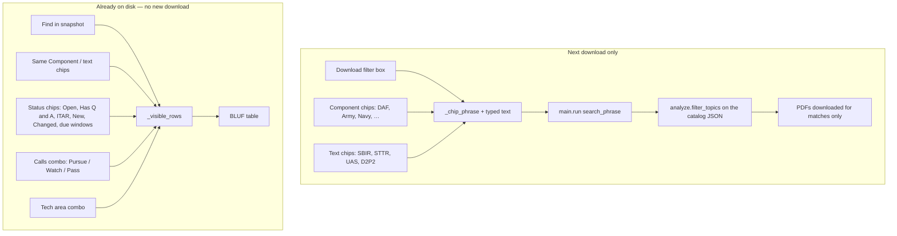
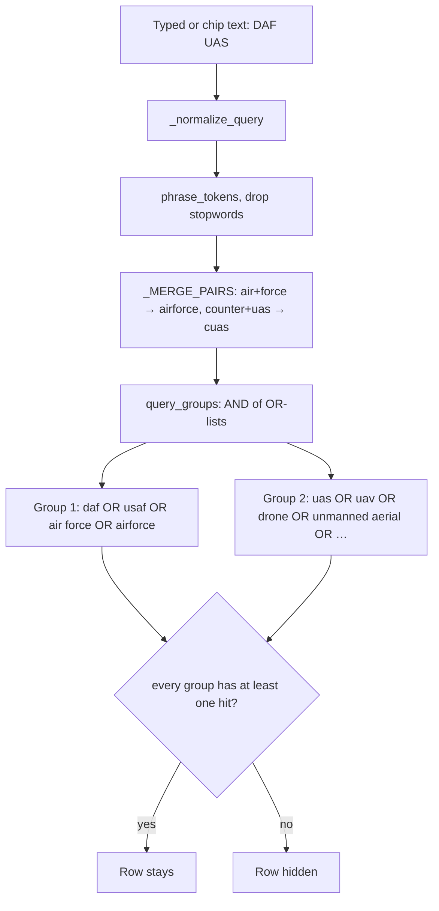
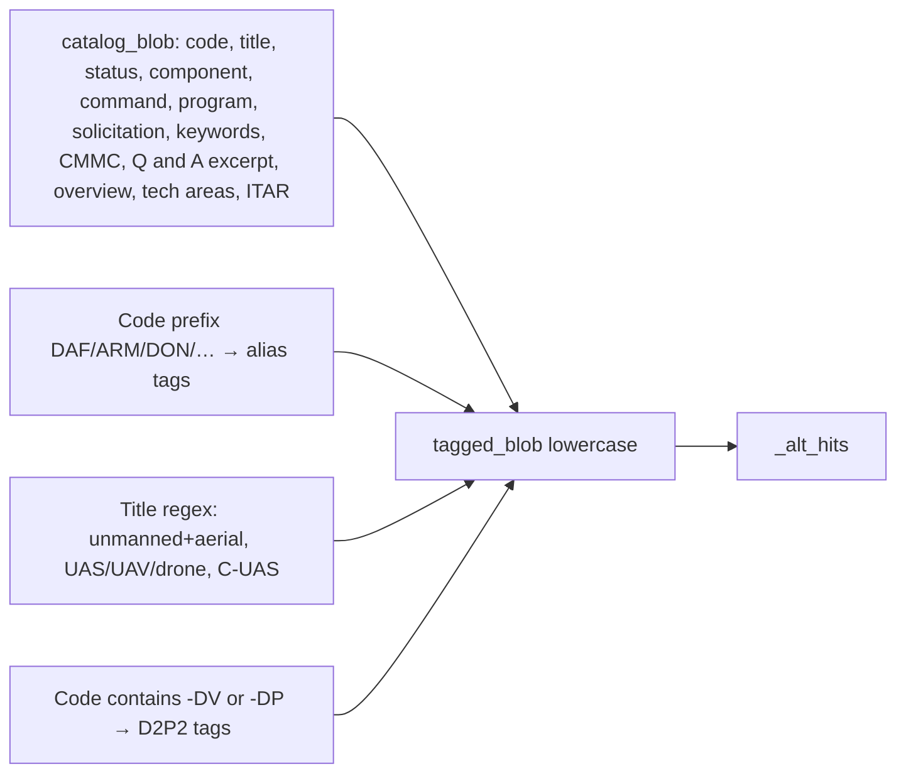
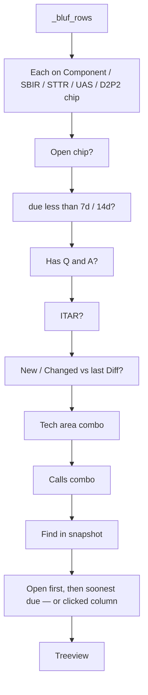
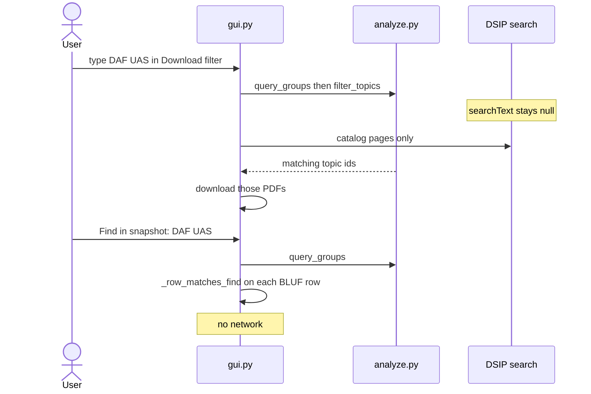

# GUI filter text matching

How the Discovery desktop app decides which topic rows stay visible
when you type in **Download filter**, click **Component** / **Narrow** chips,
or use **Find in snapshot** (Ctrl+F).

This is the user-facing companion to
[ADR 001](design-decisions/001-search-aliases.md). Architecture overview:
[CURRENT_ARCHITECTURE_README.md](../CURRENT_ARCHITECTURE_README.md).
Page-limit columns (not part of the text filter):
[PAGE_LIMIT_EXTRACTION_README.md](PAGE_LIMIT_EXTRACTION_README.md).

**The phrase never leaves the machine.** It is not sent as DSIP `searchText`.
There is no cloud model and no regex compiled from what you type.

## Two filter surfaces

| Control | When it applies | Matching style |
| --- | --- | --- |
| **Download filter** | Next **Download** click | AND-of-OR aliases on the live catalog, then PDFs |
| **Component** chips (`DAF`, `Army`, …) | Both: download phrase **and** table | Same alias algebra (`DAF` = USAF / Air Force) |
| **SBIR / STTR / UAS / D2P2** chips | Both | Same alias algebra |
| **Find in snapshot** | Table only | Literal substring **or** alias groups |
| **Open / Has Q&A / ITAR / New / Changed / due** | Table only | Not text — status, counts, or last **Diff previous…** |
| **Calls** / **Tech area** | Table only | Exact triage label or `technologyAreas` item |

Chips whose keys start with `__` (`__open__`, `__qa__`, `__itar__`,
`__new__`, `__changed__`, `__due7__`, `__due14__`) are **never** appended to
the download phrase.

## AND-of-OR algebra

Each whitespace-separated token becomes an **OR-group** of frozen aliases
in `analyze._QUERY_ALIASES`. Groups are **ANDed**. The user phrase is never
treated as “require every synonym.”

Normalization before tokens:

- `air force` / `department of the air force` → `airforce`
- `c-uas` / `counter-uas` → `cuas`
- Stopwords (`the`, `of`, `for`, …) are dropped
- Adjacent pairs merge (`unmanned` + `aerial` → `uas`)

The phrase is **not** compiled as a regex (ReDoS). Matching uses
`phrase_tokens` (`[a-z0-9]+`) plus a small, escaped word-boundary check for
short needles.

### Worked example: `DAF UAS`

| Group | Alternatives | `DAF27… Illumination` | `DAF27… Unmanned Aerial` | `OSW … Counter-UAS` |
| --- | --- | --- | --- | --- |
| 1 | daf, usaf, air force, airforce | yes (code prefix `DAF`) | yes | no |
| 2 | uas, uav, drone, unmanned aerial, … | no | yes (title tags) | yes (C-UAS tags include UAS) |
| **Keep?** | | no | **yes** | no |

`UAS` also keeps Counter-UAS rows. That is accepted. Use `CUAS` when you want
the tighter group.

### How a single alternative hits

`analyze._alt_hits(alt, blob, code)`:

| Needle | Rule |
| --- | --- |
| Contains a space (`air force`, `unmanned aerial`) | Substring of the tagged blob |
| Length ≤ 3 (`daf`, `ai`, `uas`) | Word boundary in the blob, **or** `topicCode` starts with it |
| Longer (`drone`, `airforce`) | Substring of the blob |

Word-boundary on short tokens is why `AI` does **not** match `Domain`.

Cosine n-gram similarity still exists in `analyze.py` for experiments. It is
**not** a keep/drop gate (`filter_topics` deletes `min_score`).

## What the matcher reads

Download / CLI (`filter_topics` → `topic_matches_groups` → `tagged_blob`):

Find / chips on the table (`gui._row_matches_find`) use a **two-step** check
on the BLUF row already in memory:

1. **Literal:** case-insensitive substring of visible columns plus note,
   Q&A excerpt, keywords, overview paragraph, ITAR, and tech areas.
2. **Aliases:** if the literal miss, rebuild a fake catalog record from
   `code`, `title`, `client`, `program`, `status`, `problem` and run
   `topic_matches_groups`.

A row stays if **either** step hits. That is why Find `illumination` still
works on a title that has no glossary entry, and Find `DAF` still works when
the client cell says `USAF`.

## Table pipeline (`_visible_rows`)

Filters apply **in this order**, each one narrowing the previous list:

`due < 7d` uses `due_days_int`. `closed` is `-1`, so closed rows never pass
a due window. `today` counts as `0`.

**New** / **Changed** stay empty until you run **Diff previous…**. They
compare `topicCode` via `snapshot_diff`.

## Download vs Find — same glossary, different corpus

## Chip → download phrase

`_chip_phrase` joins checked keys that are **not** `__*` (so `DAF` and `UAS`
go to `main.run`, but `Open` and `due < 7d` do not). The download button
label switches to **Download matching opportunities** when that phrase or the
typed filter is non-empty.

Chips, Find, call filter, and tech area are persisted in
`~/.dsip_downloader_state.json` on this machine only.

## What this is not

- Not DSIP website search (that box is unused).
- Not a boolean language (`OR`, `-cuas`, quotes). Use another chip or a
  second Find pass.
- Not a neural / Ollama query. A later opt-in local model is only recorded in
  [ADR 010](design-decisions/010-optional-local-llms.md).
- Not SAM.gov / Grants.gov / GovWin search.

## Code map

| Piece | File |
| --- | --- |
| Glossary, groups, tagged blob, `_alt_hits` | `analyze.py` |
| Catalog keep/drop for download | `analyze.filter_topics` |
| Table narrowing | `gui.App._visible_rows` |
| Literal + alias Find | `gui.App._row_matches_find` |
| Download phrase from chips | `gui.App._chip_phrase` |
| Tests | `test/test_aliases.py`, `test/test_gui.py` |
