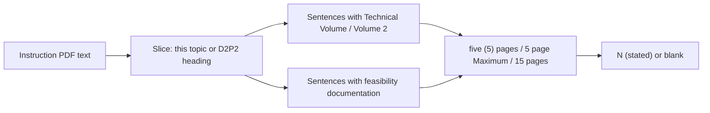

# How tech-vol and feasibility page limits are extracted

Companion to [ADR 011](design-decisions/011-volume-page-limits.md). Architecture
overview: [CURRENT_ARCHITECTURE_README.md](../CURRENT_ARCHITECTURE_README.md).

The table columns **Tech Vol Page Limit** and **Feasibility Study Page Limit**
are **not** DSIP catalog fields. They are quoted from the local component
instruction PDF (the same file **Open instruction PDF** opens).

## What you should see

| Cell | Meaning |
| --- | --- |
| `5 (stated)` | The instruction PDF states five pages for that volume |
| `15 (stated)` | The instruction PDF states fifteen pages |
| `n/a` | Feasibility study does not apply (Phase I) |
| *(blank)* | No number was found. **Not** a DoW typical ceiling |

OSD / DRPM UxS Direct to Phase II topic `OSW27BZ01-DV002` is the truth
benchmark: **5 (stated)** / **5 (stated)**. That is a DRPM short-form
deviation from the usual 15-page D2P2 tech volume.

## Where the text comes from

1. Shared PDFs land in `solicitation_documents/` during a download.
2. Each topic keeps a short list of its preface + component instruction
   (`instructionPdfs` on the row).
3. If that list is empty (catalog just arrived), the app matches files by
   component (`OSW`/`DRPM`, `DAF`, `NAVY`, `ARMY`, `DARPA`).
4. `pypdf` reads at most 40 pages / 12 MB per file. Topic-sheet PDFs are a
   fallback only; the cap almost always lives in the instruction book.

Without `pypdf`, every cell stays blank. `python gui.py` installs it into
*that* Python on first launch if it is missing (conda `base` often lacks it).

## How a number is chosen

- Combined books (Phase I + D2P2 in one PDF) keep the longest “apply to
  topic CODE” section, skipping the one-line cover teaser.
- A feasibility “5 pages” in the same sentence as tech vol is not counted as
  the tech-vol cap.
- Score ≤ 0 (wrong phase) is rejected rather than guessed.

## When the GUI fills the columns

| Moment | What happens |
| --- | --- |
| Catalog lands | Cells blank (no instruction PDF yet) |
| Solicitation PDFs finish | Every row is recomputed |
| Each topic PDF finishes | Row refresh (overview / TRL too) |
| Download finished or **Open snapshot** | Recompute from disk, even if `manifest.json` still has empty strings |

## Verify this topic

1. Download or **Open snapshot** so
   `solicitation_documents/OSW-DRPM_SBIR_27BZ_R1.pdf` is on disk.
2. Select `OSW27BZ01-DV002` (OSD / DRPM UxS, Direct to Phase II).
3. Table and Topic pane: Tech vol **5 (stated)**, Feasibility **5 (stated)**.
4. **Open instruction PDF** and search for `five (5) pages` under
   DIRECT TO PHASE II (D2P2) PROPOSAL GUIDELINES.

Automated check: `test_osw_dv002_drpm_uxs_page_limits_are_five_and_five` in
`test/test_analyze.py`, fixture `test/fixtures/OSW-DRPM_SBIR_27BZ_R1.pdf`.
