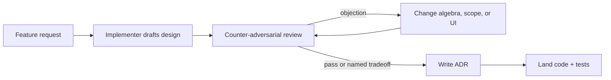

# ADR 000 — Template and counter-adversarial process

**Status:** accepted  
**Date:** 2026-10-30

## Context

The user required every major feature and implementation choice to go through a
**counter-adversarial agent review**, then be written down with diagrams, why,
and tradeoffs. Without a process, reviews become after-the-fact justifications.

## Decision

1. One Markdown file per decision under `docs/design-decisions/`.
2. Numbered `NNN-slug.md`. Status is `accepted`, `superseded`, or `rejected`.
3. Required sections: Context, Decision, Why, Architecture, Tradeoffs
   (pros/cons), Counter-adversarial review, Consequences.
4. The adversarial pass is a **second reader** whose job is to break the
   design: false positives, ToS/account flags, data leaving the machine,
   silent empty results, extra dependencies, and “we cloned the competitor.”
5. Code does not merge in spirit until at least one adversarial objection is
   either fixed or explicitly accepted as a named tradeoff.

## Why

Written decisions survive the next UI pass. The adversarial role catches the
class of bugs this repo already hit: cosine used as a keep/drop gate, short
tokens matching inside longer words, and GitHub flagging unsigned binaries.

## Architecture

## Tradeoffs

| Pros | Cons |
| --- | --- |
| Future-us can see *why* DAF matches USAF | Extra Markdown to keep in sync |
| Forces the “empty result” failure mode into tests | Review can rubber-stamp if we skip objections |
| Keeps scope off CRM / SAM-wide clones | Slower than “just ship the filter” |

## Counter-adversarial review

- **Objection:** ADRs become marketing. **Fix:** each ADR must name a rejected
  alternative and a residual risk.
- **Objection:** Reviewer is the same author. **Mitigation:** checklist in
  [004](004-adversarial-review.md); tests must encode the attack (e.g. `AI`
  must not keep a “Domain” title).

## Consequences

New filters, UI chrome, export, and snapshot-diff land with an ADR. Trivial
typos do not.
