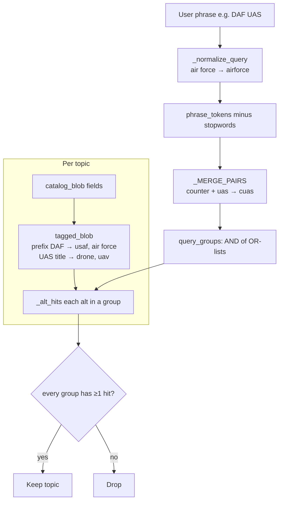

# ADR 001 — Local AND-of-OR alias search

**Status:** accepted  
**Date:** 2026-10-30  
**Code:** `analyze.py` (`query_groups`, `tagged_blob`, `filter_topics`)  
**Tests:** `test/test_aliases.py`, fixture `test/fixtures/open_topics_sample.json`

## Context

The Filter phrase field was a substring + char-ngram cosine keep/drop. Typing
`DAF` or `UAS` returned **zero** rows even though the open catalog had Air
Force topics (`topicCode` prefix `DAF`, `component` `USAF`) and drone topics
whose titles say “Unmanned Aerial Systems,” not the letters U-A-S.

Root causes the counter-agent named:

1. `"uas"` is **not** a substring of `"unmanned aerial systems"`.
2. DSIP stores the service as `USAF` / `AFMC`, not the colloquial `DAF`.
3. Cosine on a 3-character query vs a long blob is a **false empty** (and
   conversely a **false green** on unrelated long overlap).
4. AND of every synonym (`daf` AND `usaf` AND `air force`) would make `DAF`
   *worse*, not better.
5. Tokens of length ≤ 3 as raw substrings match inside other words (`AI` in
   `Domain`).

The phrase must stay **local**. It is never sent as DSIP `searchText`.

## Decision

- Expand each user token into an **OR-group** of frozen in-repo aliases.
- **AND the groups.** `DAF UAS` means (Air Force family) AND (UAS family).
- Inject canonical tags from `topicCode` prefix, `component`, and title/command
  regexes (unmanned/uncrewed + aerial/air/aircraft, C-UAS, UxS, drone/UAV).
- Word-boundary match for needles of length ≤ 3; prefix match on `topicCode`.
- Ignore cosine `min_score` as a keep/drop gate. Cosine may still rank later;
  it must not hide rows.
- Drop stopwords (`the`, `of`, …) after normalizing `air force` → `airforce`.
- Do **not** compile the user phrase as a regex.

## Why

This is the cheapest way to beat the DSIP website search and the SaaS tools’
keyword boxes on **this** dataset: DoD open topics use agency codes and
expanded English that a three-letter filter will never hit unaided.

## Architecture

Example: `DAF UAS`

| Group | Alternatives | DAF illumination | DAF Unmanned Aerial | OSW Counter-UAS |
| --- | --- | --- | --- | --- |
| 1 | daf, usaf, air force, airforce | yes (code prefix) | yes | no |
| 2 | uas, uav, drone, unmanned aerial, … | no | yes | yes |
| **Keep?** | | no | **yes** | no |

## Tradeoffs

| Pros | Cons |
| --- | --- |
| `DAF`, `USAF`, `Air Force` are the same query | Glossary will drift from new DoD jargon |
| `UAS` hits titles that never say “UAS” | C-UAS topics also match `UAS` (accepted) |
| `DAF UAS` is a real AND, not “all synonyms” | No boolean `-cuas` / OR syntax |
| Short tokens cannot match `Domain` | Prefix `DAF` will not match a hypothetical code that only says USAF in prose if tagging fails |
| Never phones DSIP with the phrase | Will not search SAM.gov, SBIR.gov, or closed topics |

### Rejected alternatives

| Alternative | Why rejected |
| --- | --- |
| Send phrase as DSIP `searchText` | Empty or unrelated remote results; leaks query; ToS/account risk |
| AND of every synonym | `DAF` would require the blob to contain every expansion |
| Neural / HuggingFace embeddings | Network, model download, ToS flags, not needed for acronyms |
| Cosine keep/drop with `min_score` | False empty on short queries; false green on long n-gram overlap |
| ttk / SQL full-text | SQLite FTS is extra moving parts for ~tens of topics |

## Counter-adversarial review

| Attack | Result |
| --- | --- |
| `UAS` vs “Unmanned Aerial Systems” with no substring `uas` | Must keep. Covered by phrase alts + title tagging. |
| `DAF` vs `component: USAF` | Must keep via code prefix and injected aliases. |
| `DAF UAS` returning illumination **or** OSW C-UAS | Fail the AND. Test `test_daf_uas_is_and_of_or_groups`. |
| `AI` keeping a “Domain Assurance” title | Word-boundary. Test `test_ai_word_boundary_does_not_match_domain_or_assurance`. |
| User types `(a+)+` | Tokens only; not compiled as regex. |
| Glossary downloaded at runtime | Frozen in-repo dicts only. |
| Filter applied *after* PDF download | Still downloads only matches (saves bandwidth); table Find is a second, client-side pass. |

**Residual risk:** a topic about drones that never says unmanned/uncrewed/UAS/UAV/drone/UxS in catalog fields will miss. We do not read PDFs to decide the filter (that would require downloading first). Accepted.

## Consequences

GUI hint text names `DAF` / `UAS` / `Air Force`. CLI `--query` and **Find in
table** use the same matcher (substring OR alias groups) so the two boxes cannot
disagree. Adding a new acronym is a dict edit plus a fixture row, not a model.
