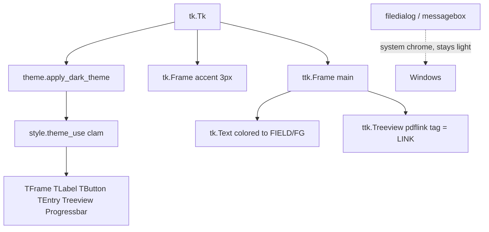

# ADR 002 — Dark clam Tkinter theme

**Status:** accepted  
**Date:** 2026-10-30  
**Code:** `theme.py`, applied from `gui.py`

## Context

The first GUI used default light ttk. The user asked for a dark, “sexy”
desktop UI. Constraints: stdlib Tkinter only (no ttkbootstrap, no customtkinter,
no web UI), Windows-first, PyInstaller one-file.

## Decision

- Force ttk theme **clam**. Windows `vista` / `xpnative` ignore most color
  configures, so a dark palette on those themes looks like a broken light app.
- Palette: background `#16181d`, panel `#1e222a`, accent `#3ddc97`, selection
  `#1f6feb`, link `#7dd3fc`.
- Style `Accent.TButton` for the download action; `Hint.TLabel` for muted copy;
  Treeview heading hover uses selection blue.
- A 3px accent strip at the top of the window.
- Native `filedialog` / `messagebox` stay system-light. That is documented,
  not a bug we will “fix” with a fake dialog clone.

## Why

Clam is the only bundled ttk theme that honors background/foreground maps on
Windows. A third-party theme pack would add a dependency, enlarge the exe, and
is another unsigned binary surface. The accent green is the one non-gray signal
on an otherwise quiet dark panel — enough contrast for the primary action
without neon-on-black kitsch.

## Architecture

## Tradeoffs

| Pros | Cons |
| --- | --- |
| No extra UI package | Native dialogs mismatch the dark window |
| Works in the frozen exe (Tcl/Tk already bundled) | clam widgets look slightly flatter than vista |
| Accent button is obvious | High-contrast / forced-colors Windows modes may fight the palette |
| Disabled-state map keeps muted text readable | Tk `Text` in `disabled` can still gray on some Windows builds |

### Rejected alternatives

| Alternative | Why rejected |
| --- | --- |
| ttkbootstrap / azure / sun-valley themes | Third-party; not stdlib; packaging risk |
| CustomTkinter / Dear PyGui | New runtime; not the existing Tk app |
| Dark web UI in a local browser | Different product; more attack surface |
| Leave vista theme and only recolor labels | Headings and Treeview stay white — looks unfinished |

## Counter-adversarial review

- **Objection:** “Sexy” means animation, glass, custom title bar. **Reject.**
  Custom title bars break accessibility and PyInstaller DPI. Contrast + one
  accent is the bar.
- **Objection:** Dark theme hides the disabled Download button. **Fix:**
  `style.map` sets disabled background `#2a2f38` and muted foreground.
- **Objection:** PDF “links” look like normal cells. **Fix:** `pdflink` tag
  uses `theme.LINK`; click still keyed off the `pdf` column **name**, not `#12`.
- **Objection:** Screenshot in README is the old light UI. **Residual:** update
  when a new capture is taken; do not invent a fake PNG.

## Consequences

`gui.py` calls `apply_dark_theme` before building widgets. Tests assert
`root.cget("bg")` is the palette background.
