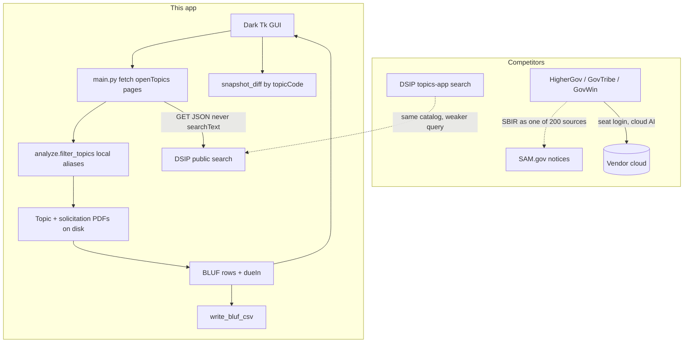
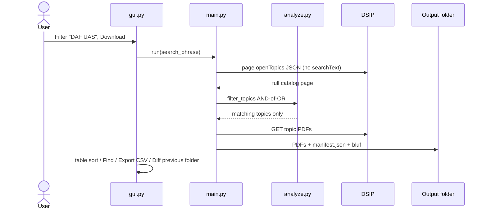

# ADR 003 — Beat SaaS BD tools on a local DSIP snapshot, not a CRM clone

**Status:** accepted  
**Date:** 2026-10-30  
**Code:** `analyze.py` (BLUF, CSV, snapshot diff), `gui.py` (sort, find, export, compare)

## Context

Gov-opportunity research is dominated by **cloud CRMs** that wrap SAM.gov and
charge for seats, alerts, and AI credits:

| Product | What it is | 2026-ish price (published or reported) |
| --- | --- | --- |
| [SAM.gov](https://sam.gov/) | Official federal notices | Free |
| [SBIR.gov](https://www.sbir.gov/) / [DSIP topics](https://www.dodsbirsttr.mil/topics-app/) | Official SBIR/STTR catalogs | Free |
| [HigherGov](https://www.highergov.com/) | Broad search, forecasts, SBIR, AI, MCP | ~$500/yr individual, ~$2,500/yr team |
| [GovTribe](https://govtribe.com/plans) | Discovery + pursuits + AI credits | ~$1,900–$2,100/yr per seat |
| [Deltek GovWin IQ](https://www.deltek.com/products/govwin/federal/) | Analyst pre-RFP intel, includes SBIR | Quote; reported ~$13k–$119k/yr |

They win at **breadth** (SAM + SLED + forecasts + contacts) and **workflow**
(pipelines, alerts, teaming). They lose at the job this repo exists for: a
**complete, offline, inspectable copy** of the current DoD DSIP *open topics*
list, with topic PDFs on disk, a BLUF table, and search that understands DoD
acronyms — with **no account, no phrase sent to a vendor, no seat license**.

Cloning their CRM would be a worse HigherGov. We do not do that.

## Decision

Stay a **local catalog appliance**. Add only features that the SaaS tools are
structurally bad at for DSIP:

| Gap in the SaaS / official UI | What we ship |
| --- | --- |
| Keyword boxes miss `DAF` / `UAS` | Alias AND-of-OR search ([001](001-search-aliases.md)) |
| No one-click dump of every open topic PDF | Thread-pooled local download + `manifest.json` |
| AI summaries leave the machine / cost credits | Extractive BLUF from on-disk PDFs via optional `pypdf` |
| Exports capped (GovTribe 3,000 rows) and behind a login | Unlimited CSV of the current table (Find + sort applied) |
| No diff of *your last folder* vs today | `snapshot_diff` on two `manifest.json` files |
| Deadlines buried in ISO fields | `dueIn` countdown column + sortable headers |
| Must stay online to re-filter | Client-side **Find in table** after the snapshot is local |

Out of scope on purpose: SAM-wide coverage, email alerts, capture CRM, teaming
databases, HuggingFace/OpenAI, third-party OAuth, public unsigned `.exe`.
A later **optional local** GGUF/Ollama query path is documented in
[010](010-optional-local-llms.md) and is not in the default product.

## Why

A 10-person SBIR shop does not need GovWin’s pre-RFP graph to answer “which
open DSIP topics this week are Air Force drones, what is the objective, and
when is it due?” That answer is a local snapshot plus aliases. Price to beat:
**$0 and air-gappable**, vs $500–$29k/yr.

## Architecture

## Tradeoffs

| Pros | Cons |
| --- | --- |
| Offline after one fetch; phrase never sold to a vendor | No SAM/SLED/forecast coverage |
| Full PDFs, not a 200-character blurb | Must re-run to see new topics (no email alert) |
| Snapshot diff is *your* folders, not a vendor timeline | Diff is code/title/status/endDate only |
| CSV is the visible table (Find honored) | Not a pipeline CRM |
| pypdf bundled in the exe for BLUF | Slightly larger freeze; extraction still bounded |

### Rejected alternatives

| Alternative | Why rejected |
| --- | --- |
| Scrape SAM.gov into this GUI | Different ToS, different schema, years of work |
| Alerts / watch lists in the cloud | Needs identity, hosting, and the flagged-account class of risk |
| “AI match score” via an API | Credits, leakage of the topic list |
| ttkbootstrap dashboard clone of GovTribe | Looks like a CRM; extra deps |

## Counter-adversarial review

- **Objection:** “Beat them” means more features than GovWin. **Reject.** We
  beat them on *DSIP completeness + local acronym search + no seat tax*. Breadth
  is their product.
- **Objection:** Export + diff recreates a mini-CRM. **Fix:** no saved pursuits,
  no contacts, no cloud sync. Diff reads two folders the user already has.
- **Objection:** Opening PDFs from the table is a path traversal. **Existing
  control:** `resolve_pdf` requires a real `%PDF-` file inside `output_dir`.
- **Objection:** Bundling pypdf in the exe pulls a non-stdlib dep into CI.
  **Accept.** BLUF without pypdf is an empty objective column — a worse product.
  Bound reads (`MAX_PDF_BYTES`, `MAX_PDF_PAGES`).
- **Objection:** Public `.exe` download to “beat” SaaS distribution. **Reject.**
  Unsigned PyInstaller Releases already flagged the GitHub account.

## Consequences

README points here. GUI toolbar: Find in table, Export CSV, Diff previous
folder. Competitive claims stay honest: **DoD open-topic snapshot appliance**,
not a GovWin replacement.
