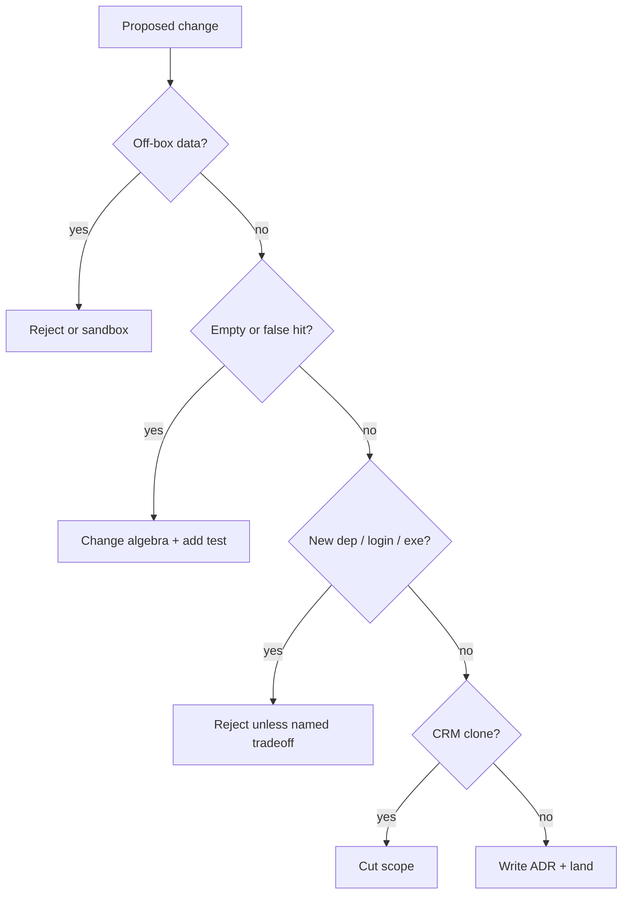

# ADR 004 — Counter-adversarial review log (2026-10-30 modernization)

**Status:** accepted  
**Date:** 2026-10-30

## Context

The modernization asked for dark UI, competitive features, a working `DAF` /
`UAS` filter, and an adversarial pass on **every** decision. This log is the
pass. Objections that were accepted as residual risk are marked **accepted**.
Objections that changed the design are marked **fixed**.

## Checklist the counter-agent runs

1. Can the feature send user text or topic lists off-box?
2. Can it produce a silent empty table for a query that should hit?
3. Can it produce a false hit (`AI` ⊂ `Domain`)?
4. Does it require a new dependency, model, or login?
5. Does it clone a SaaS CRM instead of deepening the local snapshot?
6. Does it re-enable a public unsigned `.exe` or curl-to-installer README?
7. Are native security controls (`resolve_pdf`, no `searchText`) still on?

## Findings

| ID | Objection | Verdict | Where it landed |
| --- | --- | --- | --- |
| A1 | Cosine `min_score` as keep/drop empties `DAF` / `UAS` | **Fixed** | `filter_topics` ignores `min_score` |
| A2 | AND of every synonym makes `DAF` require all expansions | **Fixed** | AND-of-OR groups |
| A3 | `"uas"` substring cannot hit “Unmanned Aerial Systems” | **Fixed** | Alias list + title tagging |
| A4 | `component` is `USAF`, not `DAF` | **Fixed** | Code-prefix aliases injected into blob |
| A5 | `AI` matches `Domain` | **Fixed** | Word-boundary for needles ≤ 3 chars |
| A6 | Sending the phrase as DSIP `searchText` | **Rejected** | Still local only |
| A7 | HuggingFace / OpenAI “semantic” rewrite | **Rejected** | Extractive BLUF + aliases |
| A8 | ttkbootstrap for a sexier theme | **Rejected** | clam in `theme.py` |
| A9 | Custom title bar / fake dialogs | **Rejected** | Native dialogs stay light (**accepted** mismatch) |
| A10 | `UAS` also matches Counter-UAS topics | **Accepted** | C-UAS *is* a UAS topic; `cuas` still exists as a tighter group |
| A11 | Table Find during download restores stale rows | **Fixed** | Clear `_bluf_rows` when a run starts |
| A12 | PDF click hardcoded as column `#12` | **Fixed** | Resolve by heading name `pdf` (dueIn inserted a column) |
| A13 | Snapshot diff as a cloud timeline | **Rejected** | Two local `manifest.json` folders |
| A14 | CSV of secrets / PII | **Accepted** | Catalog is public DoD topics; CSV is that table |
| A15 | Bundle pypdf (supply chain, exe size) | **Accepted** | Needed for BLUF; hiddenimport + `requirements-build.txt` |
| A16 | Public GitHub Release of the exe | **Rejected** | Artifact-only; no README download links |
| A17 | Boolean query language (`OR`, `-cuas`) | **Rejected for now** | Space = AND of groups; document in 001 |
| A18 | Reading PDFs to decide the filter | **Rejected** | Would download everything first; residual miss if title is silent |
| A19 | “Beat GovWin” by adding alerts + SAM | **Rejected** | Scope is DSIP open-topics appliance |
| A20 | User phrase compiled as regex / ReDoS | **Fixed earlier** | `phrase_tokens` only |
| A21 | **Find in table** as raw substring would miss `UAS` again | **Fixed** | Same `query_groups` / `topic_matches_groups` as the download filter, plus substring for codes/amounts |
| A22 | Write BD calls into `manifest.json` | **Rejected** | `STATE_FILE` only; see [006](006-bd-triage-pipeline.md) |
| A23 | Sync triage to GovWin / a CRM | **Rejected** | Local snapshot appliance |
| A24 | Cloud LLM fit score | **Rejected** | Human Pursue/Watch/Pass |
| A26 | Global `1`/`2`/`3` binds steal Find-box keystrokes | **Fixed** | Table-only bindings |
| A27 | Open / due chips leak into the download phrase | **Fixed** | `__*` keys excluded from `_chip_phrase` |
| A28 | Closed topics appear in due ≤7d / ≤14d | **Fixed** | `due_days_int("closed") == -1` |
| A31 | Public unsigned `.exe` for BD distribution | **Rejected** | Artifact-only |
| A36 | PDF-link cyan hid closing-soon color | **Fixed** | Urgency / Pursue tags only |
| A38 | Catalog-first PDF refresh wiped an in-progress note | **Fixed** | Commit + rebind selected row from `_triage` |
| A53 | Invalid Q&A `topicId` test could hit live DSIP | **Fixed** | Stub `open_url`; assert zero calls |
| A54 | Q&A excerpt reader lacked a traversal test | **Fixed** | `load_qa_excerpt("../secret.json")` is empty |
| A55 | Non-https guide link test asserted nothing | **Fixed** | Mock `webbrowser.open` |

## Architecture of the review loop

## Residual risks we are willing to live with

- Native file/message dialogs are light-themed on Windows.
- C-UAS rows appear for the query `UAS`.
- Topics whose catalog fields never mention a drone/Air Force synonym will not
  match until the glossary or tagging grows.
- No email watch; the user re-runs the app.
- Unsigned local builds still trip SmartScreen.

## Consequences

`test/test_aliases.py` encodes A1–A5. `test/test_gui.py` encodes dark theme +
table Find. Future features add a row to this table or a new ADR, not a silent
README sentence.
