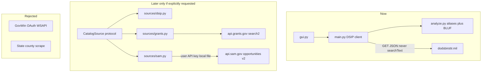
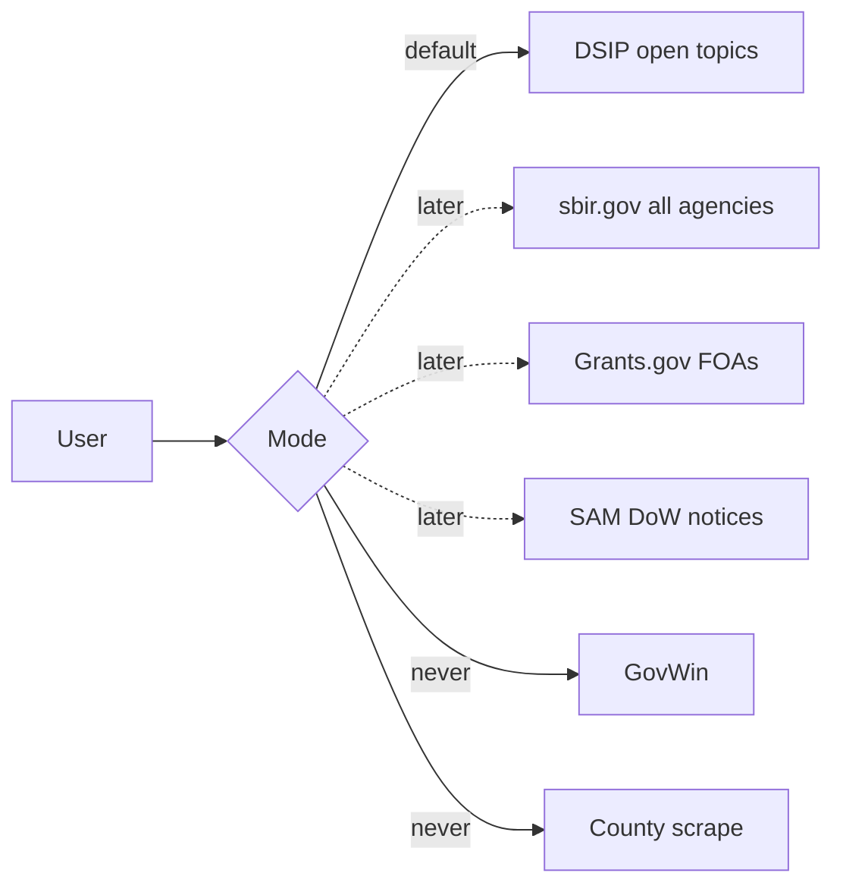

# ADR 005 — Multi-source modes (GovWin, SAM.gov, grants, SLED)

**Status:** accepted (documentation only — no clients landed)  
**Date:** 2026-10-30  
**Supersedes in part:** the “SAM-wide coverage is out of scope” line in
[003](003-competitive-local-catalog.md) is **restated**, not reversed. This ADR
is the research record for *whether* to add modes. It does **not** authorize
implementing them.

## BLUF

**Do not search GovWin. Do not scrape state or county grant portals.** There is
no national public SLED API. GovWin is a paid OAuth CRM whose terms forbid
copying or redistributing the database. Both paths turn this repo into a worse
HigherGov and collide with no-third-party-OAuth, PolyForm Noncommercial, and
the GitHub account flag for shady distribution.

**Keep today’s DSIP open-topics pull as the default product** (call it
**SBIR / DSIP mode**). That is still the wedge: every open DoW topic PDF on
disk, `DAF`/`UAS` aliases, no seat license, phrase never sent as DSIP
`searchText`.

**Optional later modes are feasible only against official, read-only public
APIs**, behind an explicit GUI switch, with records mapped into the existing
`manifest.json` `topics` / `bluf` shape. Ranked:

| Mode | Official source | Verdict |
| --- | --- | --- |
| **SBIR / DSIP** (current) | DSIP public search + topic PDF routes | **Keep** |
| **All-SBIR** | [sbir.gov solicitations API](https://www.sbir.gov/api/solicitation) (HHS, NSF, DOE, NASA, …) | **Later**, if the API is healthy |
| **Federal grants** | [Grants.gov `search2` / `fetchOpportunity`](https://grants.gov/api/api-guide) (no key) or daily [XML extract](https://www.grants.gov/xml-extract) | **Later**, opt-in |
| **DoW-wide contracts** | [SAM.gov Opportunities v2](https://open.gsa.gov/api/get-opportunities-public-api/) + **user’s own** API key + DoD org filter | **Later**, opt-in, **scoped search** (cannot download “all”) |
| **GovWin IQ** | Deltek WSAPI (OAuth2, client id/secret) | **Never** |
| **State / county grants** | BidNet, DemandStar/OpenBid, PlanetBids, 50+ state portals | **Never as scrape**; README “go here” links only |

This file is the decision. **No `sources/sam.py`, no Grants client, no GUI
combobox** until a later request that names one official API and accepts the
tradeoffs below.

## Context

The app is a **local DSIP catalog appliance** ([003](003-competitive-local-catalog.md)).
Users reasonably ask: can it also search GovWin, SAM.gov, federal grants, and
state/county grants, with modes such as “grants,” “SBIR,” “DoW-wide”?

Those are different products sharing an English word (“opportunity”):

| User label | What it actually is |
| --- | --- |
| SBIR / DSIP | DoW/DoD *topic sheets* + submission on dodsbirsttr.mil |
| All-SBIR | Eleven civilian + defense agencies; submit on DSIP, eRA, Research.gov, NSPIRES, … |
| DoW-wide | Ambiguous: DSIP topics **or** all DoD *contract notices* on SAM **or** DoD *grants* on Grants.gov |
| Federal grants | Assistance listings (FOAs) on Grants.gov — not contracts, not topic codes |
| State / county | No national feed; each jurisdiction has a portal or a paid bid network |
| GovWin | Analyst CRM wrapping SAM + SLED + contacts behind a seat |

[`main.py`](../../main.py) is a DSIP client (`SEARCH_URL`, `SEARCH_PARAM`,
`topicId`, solicitation `uploadId`). [`gui.py`](../../gui.py) is thin: it calls
`main.run()` and paints `manifest.json`. [`analyze.py`](../../analyze.py) BLUF
assumes DSIP OBJECTIVE/TRL/Phase I–II text.

## Decision

1. **Default mode remains DSIP open topics.** Relabel in copy as SBIR / DSIP
   when a second mode exists. Do not build the second mode in this change.
2. **Never** integrate GovWin IQ (API or scrape).
3. **Never** scrape BidNet, DemandStar, PlanetBids, or state eProcurement
   HTML as a “county grants mode.”
4. **If** a second mode is built later, it must be: official public API,
   opt-in in the GUI, local filter after fetch where the API allows a full
   snapshot, user-supplied secrets never committed, per-source BLUF (do not
   apply DSIP typical award ceilings to a grant), `manifest.mode` set,
   snapshot-diff only within the same mode.
5. Split the vague label **DoW-wide** into three names if they ever appear in
   the UI: **DoW SBIR (DSIP)**, **DoW contracts (SAM)**, **DoW grants
   (Grants.gov)**.

## Why

GovWin and SLED aggregators exist because the data is proprietary or
fragmented. Rebuilding them is their company. Official GSA/SBA/Grants.gov
APIs are the only path that does not repeat the unsigned-binary / ToS class
of risk this account already hit.

DSIP is still the only source that matches this app’s original job: **one
click, every open topic PDF, offline BLUF.** SAM cannot do “download all”
(mandatory date window, rate limits as low as 10 requests/day). Grants.gov
search is remote by design. SBIR.gov is a stale-possible catalog, not the
submission system.

## Architecture (current vs hypothetical later)

## Source research (facts used)

### GovWin IQ — never

Deltek **GovWin WSAPI v3** is REST/JSON for *customers*: OAuth2 (password and
refresh grants), client id/secret from the GovWin admin UI, organization-wide
limit on the order of **4,000 calls/hour**. Opportunity download is a CRM
integration (summary + related documents + contacts). Terms grant internal
use of the databases and **forbid copying, publishing, or granting third-party
access**. Price is quote-based; public comparisons report roughly
**$13k–$119k/year**.

This needs third-party OAuth, a paid seat, and would redistribute Deltek
content into `manifest.json` / CSV. Rejected.

### SAM.gov — later, scoped, user key

[Get Opportunities Public API v2](https://open.gsa.gov/api/get-opportunities-public-api/):
`GET https://api.sam.gov/opportunities/v2/search`. **`api_key` required**
(user creates it on SAM.gov Account Details — GSA, not a SaaS OAuth app).
**`postedFrom` and `postedTo` required**, range at most **one year**. `limit`
max **1000**. Notices are pre-solicitations, solicitations, sources sought,
awards — not DSIP topic sheets. Attachments are mixed. Rate limits depend on
account role and can be **10 requests/day** for unaffiliated keys.

Implication: the product cannot be “download every SAM opportunity.” A DoW
mode would be **date window + organization/NAICS/set-aside**, then local
alias filter on the page of results. The filter phrase **does** leave the
machine if used as `title=`. UI must say so.

### Grants.gov — later, opt-in, no key

[`POST https://api.grants.gov/v1/api/search2`](https://grants.gov/api/common/search2)
and `fetchOpportunity` do **not** require authentication. Search hits are
thin (id, number, title, agency, dates); money and eligibility need a detail
call per id. Daily XML extract is on the order of **80 MB**. This is
**federal assistance**, not contracts. “County governments” appear as
*eligible applicants*, not as the funder. Keyword search is remote by design.

### SBIR.gov All-SBIR — later, if healthy

[Solicitations API](https://www.sbir.gov/api/solicitation) covers agency codes
including DOW, HHS, NASA, NSF, DOE, USDA, EPA, DOC, ED, DOT, DHS. SBA warns
that listings **may lag** official agency solicitations. The public
solicitations endpoint has been **under maintenance**. DSIP remains the
authoritative DoW topic+PDF source. All-SBIR is how you see NIH/NSF/DOE
without eleven scrapers — when the API answers.

### State / county — never as a mode

There is **no national public SLED grants/bids API**. BidNet, DemandStar /
Euna OpenBid, PlanetBids, Bonfire, and fifty state portals (NJSTART, eVA, Cal
eProcure, …) are the market. Aggregators (HigherGov, GovTribe, paid BidNet
plans) exist because scraping each portal is a company. County *grants* are
even more fragmented than county *procurement*. Link out; do not scrape.

## Tradeoffs of a mode switch (if built later)

| Pros | Cons |
| --- | --- |
| One window for a shop that also chases NIH FOAs or DoD SAM notices | Product identity splits; DSIP “download all” does not generalize |
| Reuse table, CSV, PDF sandbox, reporter queue | SAM/grants **must** send query parameters to the network |
| Honest labels instead of pretending DSIP is all government | BLUF/TRL/typical-award logic is **wrong** on FOAs and RFPs |
| Grants.gov needs no key | SAM keys, 10–1000 req/day caps, date windows |
|  | Mixing sources in one Treeview without a `source` column will lie |
|  | Volume jumps from ~30 rows to thousands |

### Rejected alternatives

| Alternative | Why rejected |
| --- | --- |
| GovWin as a mode | OAuth, paid ToS, CRM clone, GitHub-flag class of risk |
| Scrape BidNet / DemandStar / state HTML | No national feed; login walls; ToS; account risk |
| “DoW-wide” as one checkbox | Three different datasets |
| Pull all SAM for a year then filter locally | Rate limits make a full snapshot unrealistic |
| Reuse DSIP BLUF on every source | False TRL and “typical $2,000,000” on grants |
| HigherGov/GovTribe MCP | Seat license and cloud AI — the thing [003](003-competitive-local-catalog.md) exists to avoid |
| Implement adapters “while we write the ADR” | Scope creep; this ADR is research, not a feature |

## What would have to change in the code (feasibility)

**Feasible.** The GUI is loosely coupled; fetch is not.

Smallest future refactor (not done here):

1. `CatalogSource` protocol: `source_id`, `fetch_catalog(reporter)`,
   `plan_downloads(records, output_dir)`, `manifest_extras()`.
2. Move DSIP constants and paging from `main.py` → `sources/dsip.py`.
3. Normalizer `to_manifest_topic(raw, source_id)` into today’s `topics[]`
   keys (`topicId`, `topicCode`, `component`, ISO dates, optional `pdf`).
4. `main.run(..., source=...)` generic loop: fetch → `filter_topics` on
   normalized rows → download plan → existing thread pool + `resolve_pdf`.
5. `bluf_row_for_source(...)` — DSIP keeps OBJECTIVE/TRL; grants/SAM mark
   TRL/funding `n/a` or use source-native fields only.
6. GUI combobox + folder prefix + `manifest["mode"]`.
7. SAM: API key from env or a local file **gitignored**; refuse SAM mode
   without it. Never bind a key into the exe.
8. Tests with fixtures; never live GovWin/BidNet.

Rough later effort: Grants.gov **1–2 weeks**; SAM DoW filter **2–4 weeks**
(key UX + backoff); All-SBIR **1–2 weeks** after the API is up. GovWin/SLED:
do not estimate because rejected.

Coupling today:

| Layer | Coupling to DSIP |
| --- | --- |
| `main.py` fetch, PDFs, manifest | High |
| `analyze.py` aliases + BLUF | High (DoD codes, topic-sheet headings) |
| `gui.py` | Low (manifest-driven) |

## Counter-adversarial review

| ID | Objection | Verdict |
| --- | --- | --- |
| M1 | Filter phrase sent as SAM `title=` or Grants `keyword` | **Allowed only in that future mode**, with UI copy that the phrase leaves the machine. DSIP mode stays local. |
| M2 | SAM API key committed or baked into the exe | **Forbidden** |
| M3 | “Download all SAM” on a 10-req/day key | **Refuse** in UI; require date + org/NAICS/set-aside |
| M4 | Scrape BidNet/GovWin HTML “because there is no API” | **Rejected** |
| M5 | Apply DSIP typical D2P2 ceilings to a grant | **False numbers** — hide or `n/a` |
| M6 | Snapshot diff across modes keyed only on `topicCode` | **Wrong IDs** — same `mode` only |
| M7 | sbir.gov All-SBIR presented as official submission | **Lie** — SBA copies can lag; show agency URL |
| M8 | Writing this ADR as cover to land SAM code now | **Rejected** — documentation pass only |
| M9 | PolyForm Noncommercial vs a company using SAM | User’s own use of GSA/Grants.gov public APIs is their affair; **this repo still must not ship keys or a commercial scraper** |
| M10 | County grants “just Grants.gov eligibility=01” | That is **federal money counties may apply for**, not county-funded grants. Do not label it county mode. |

**Residual risks if a later mode ships:** official APIs change without notice;
SAM key theft from a local file; Grants.gov keyword leakage; user confusion
when BLUF columns are empty on non-DSIP rows.

## Consequences

- Index this ADR from `docs/design-decisions/README.md` and the project
  README. **No new runtime capability.**
- A future “implement Grants mode” request must cite this file and accept
  M1, M5, and M6.
- GovWin and SLED scrape stay on the never list unless the user has a
  Deltek contract **and** we reverse the OAuth/ToS decisions in a new ADR —
  not a silent code drop.
