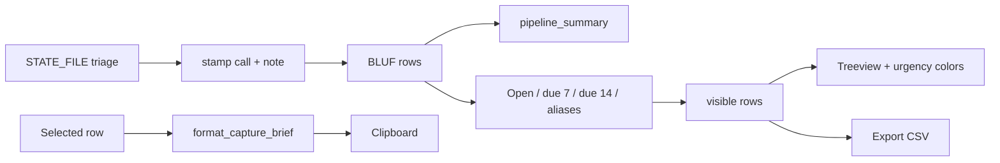

# ADR 006 — Local BD triage, pipeline strip, and capture brief

**Status:** accepted  
**Date:** 2026-10-30

## Context

A business-development manager or analyst does not live in the download log.
They live in a weekly capture meeting: what is **open**, what **closes this
week**, what we will **pursue / watch / pass**, and a paragraph they can paste
into email. The previous GUI already had catalog-first fill, chips, and a
detail pane. It still forced the user to re-derive that pipeline by eye.

## Decision

Keep the app a **local DSIP snapshot appliance**. Add analyst workflow on top
of the in-memory BLUF table:

1. A **pipeline caption** (`N shown / M topics · Open · due ≤7d · due ≤14d ·
   Pre-Release · Pursue · PDFs · agency mix`).
2. Narrow chips for **Open** and **due < 7d**, plus a **Calls** filter
   (`All / Pursue / Watch / Pass / Untagged`).
3. A **Call** column and topic-pane buttons. Keys `1` / `2` / `3` / `0` apply
   only while the table is focused.
4. A one-line **note** and **Copy brief** (code, client, due, funding, call,
   note, objective). Clipboard only.
5. Persist `{topicId: {call, note}}` in `~/.dsip_downloader_state.json`. Do
   **not** write calls into `manifest.json`.

Download filter chips that start with `__` never become the next-run search
phrase. Closed topics (`dueIn == closed` → `-1`) are **not** in due windows.

## Why

This is the piece GovWin/HigherGov sell as a pipeline. We can do it without a
seat license, a CRM, or leaving the box: the catalog is already public DoD
text, and the call is the user's judgment.

## Architecture

## Tradeoffs

| Pros | Cons |
| --- | --- |
| Capture meeting fits in one screen | Extra chips compete with alias chips |
| Calls survive a new download | Home-directory JSON is not a shared BD tracker |
| Brief is paste-ready | Unsigned typical-award wording can still be misread |
| No new dependency | Combobox drop-down may stay system-light |

## Counter-adversarial review

| ID | Objection | Verdict |
| --- | --- | --- |
| A22 | Write calls into `manifest.json` (mix opinion with the official catalog) | **Rejected** — `STATE_FILE` only |
| A23 | Sync Pursue/Pass to GovWin / a CRM | **Rejected** — ADR 005 still holds |
| A24 | LLM “fit score” | **Rejected** — extractive BLUF + human call |
| A25 | Export CSV now includes user notes | **Accepted** — columns labeled `call` and `note` |
| A26 | Bind `1`/`2`/`3` globally so Find-box typing marks rows | **Fixed** — table bindings only |
| A27 | Open / due chips become DSIP `searchText` or the download phrase | **Fixed** — `__*` keys excluded from `_chip_phrase` |
| A28 | `closed` parsed as `<= 14` and appears in “due this week” | **Fixed** — `due_days_int("closed") == -1`; window is `0 <= d <= N` |
| A29 | Persist only `topicId`, drop the row if DSIP omits it | **Accepted** — fallback is `code` |
| A30 | Brief quotes a *typical* ceiling as a real award | **Accepted** — funding string already says `typical` |
| A31 | Public unsigned `.exe` so BD can “just download” | **Rejected** — artifact-only |
| A32 | Urgency color + selected row contrast | **Accepted** residual |
| A33 | State file is plaintext in the home directory | **Accepted** — public catalog + user notes; no secrets |
| A34 | Chips ∩ call filter can empty the table | **Accepted** — caption still shows `0 shown / N topics` |
| A35 | Notes searchable = leaking capture strategy if CSV is mailed | **Accepted** — user chose Export |
| A36 | Whole-row PDF cyan hid closing-soon color | **Fixed** — drop `pdflink` row tag; urgency / Pursue colors only |
| A37 | Pursue before the note field is bound writes `""` over a restored note | **Fixed** — `_commit_note` only if `_note_bound_key` matches |
| A38 | PDF `item_done` / finish reload replaces the BLUF dict and the next commit writes `""` | **Fixed** — commit, stamp from `_triage`, `_rebind_selected` |

## Residual risks

- Native combobox list and file dialogs stay light-themed on Windows.
- Calls do not roam across machines unless the user copies the state file.
- A topic that changes `topicId` between cycles loses its call.
- No calendar invite or email watch; the user re-opens the snapshot.

## Consequences

`analyze.pipeline_summary`, `format_capture_brief`, and `due_days_int` are the
unit surface. `test/test_gui.py` covers Open/due-7 chips, phrase isolation,
triage persist/filter, note Find, and Copy brief. README describes the capture
loop without promising a CRM.
