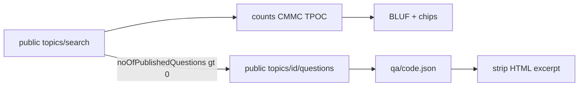

# ADR 007 — Published Topic Q&A in the snapshot; DSIP component chips

**Status:** accepted  
**Date:** 2026-10-30

## Context

The DSIP Topics and Topic Q&A page shows a speech-bubble column, published
answers, and a **Component** filter (Army, CBD, DHP, DLA, DARPA, DTRA, MDA,
Navy, NGA, NOAA, NSF, OSD, SOCOM, NASA, plus DAF/USAF in the catalog). Asking
a question requires a DSIP account. Reading published Q&A does not.

The public catalog JSON already returns `noOfPublishedQuestions`,
`topicQuestionCount`, `topicQAStatusDisplay`, `cmmcLevel`, and `topicManagers`.
The public URL

`GET /topics/api/public/topics/{topicId}/questions`

returns the published Q&A list (confirmed 200, no login).

## Decision

1. **Yes — put published Q&A in the download.** Save `qa/{topicCode}.json` and
   surface counts / an excerpt in the BLUF table. This is the same class of
   public catalog data as the topic PDF.
2. **Do not** add login, ask-a-question, or HTML scrape of the Q&A panel.
3. Expand **Component** chips to the DSIP filter list. Keep workflow chips
   (`SBIR`, `STTR`, `UAS`, `D2P2`, `Open`, `Has Q&A`, due windows) on a second
   row. Open / due / Has Q&A never become the next-run search phrase.
4. Defer `/topics/{id}/details` (keywords, technology areas, ITAR, phase
   write-ups) as a follow-up. Those are also public, but they are another
   request per topic and the PDF already holds the objective.

## Why

Published answers change the requirement. A BD manager who only has the PDF
misses “use 220VAC” clarifications. The component chips match the portal the
analyst already uses.

## Architecture

## Tradeoffs

| Pros | Cons |
| --- | --- |
| Q&A without a DSIP login | Extra GETs only for topics with published answers |
| Component chips match the portal | Many chips; some are zero on a given cycle |
| TPOC name is on the topic card | Email is public on DSIP; we show the name, not a mailer |

## Counter-adversarial review

| ID | Objection | Verdict |
| --- | --- | --- |
| A39 | Add DSIP login so the user can *ask* Q&A | **Rejected** — screenshot says login is required to ask; we stay read-only |
| A40 | Scrape the Q&A HTML panel | **Rejected** — public `/questions` JSON |
| A41 | Store TPOC email in CSV | **Accepted residual** — name in BLUF; email stays in raw catalog JSON only if DSIP sent it |
| A42 | Fetch Q&A for every topic, including zeros | **Fixed** — only `noOfPublishedQuestions > 0` |
| A43 | Leave HTML / nested JSON answer blobs in the table | **Fixed** — `strip_html` / `qa_answer_text` |
| A44 | Invalid `topicId` in the Q&A URL | **Fixed** — `TOPIC_ID_PATTERN` |
| A45 | Component chips sent as DSIP `components=` | **Rejected** — still local alias filter; `SEARCH_PARAM` unchanged |
| A46 | NSF/NASA/NOAA chips imply we scrape those agencies' portals | **Rejected** — they are DSIP catalog `component` values only |
| A53 | Invalid `topicId` test could hit live DSIP if the regex loosened | **Fixed** — stub `open_url` and assert it was never called |
| A54 | `load_qa_excerpt("../secret.json")` untested | **Fixed** — same resolve-under-output_dir refuse as PDFs |

## Residual risks

- Nested `answer` JSON is a DSIP quirk; if they change the envelope, excerpt
  falls back to stripped text.
- A cycle with no Army/SOCOM/NSF topics makes those chips empty (caption shows
  `0 shown / N`).
- `/details` keywords are not in Find yet.

## Consequences

`test/test_aliases.py` covers DARPA/NSF/STTR chips. `test/test_main.py` covers
Q&A save + invalid id. GUI Has Q&A is local, like due windows.
