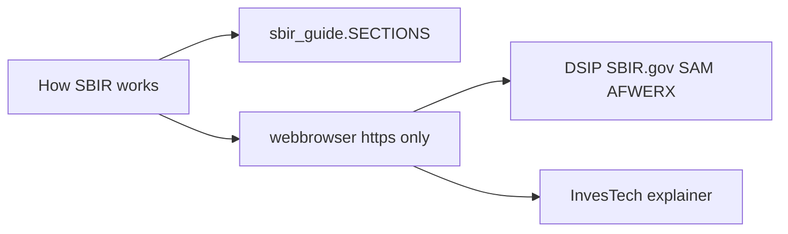

# ADR 008 — Offline “How SBIR works” tab

**Status:** accepted  
**Date:** 2026-10-30

## Context

A BD manager asked for a “How SBIR program works” tab, using
[InvesTech’s AFWERX open- vs specific-topic page](https://investech-consulting.com/programs/afwerx-sbir/)
as the outline (eligibility, open vs specific, pre-release Q&A, registrations,
D2P2, award ceilings in component instructions, CMMC, AFWERX vs DSIP).

That page is a commercial article. Reprinting it would be a copyright and
affiliation problem. Fetching it at runtime would add a third-party network
dependency and a lead-gen surface.

## Decision

1. Add a `ttk.Notebook` with **Catalog** and **How SBIR works**.
2. Ship **original** process notes in `sbir_guide.py` (public SBA/DSIP/DoW
   rules, plus how this app maps onto them).
3. Do **not** scrape or cache InvesTech. List their URL last, labeled
   “third-party / unaffiliated.” Official DSIP, SBIR.gov, SAM.gov, and AFWERX
   links come first. Only `https://` URLs open in the system browser.
4. Do **not** paste their marketing, contact block, or “free funding report.”
5. Do **not** freeze InvesTech’s release counts. A **dated FY27 monthly
   calendar snapshot** may live in this tab, labeled as a snapshot, with
   navysbir.com as a citation only. Confirm every deadline on DSIP. **Never
   scrape navysbir.com.**

## Why

Capture people need the process next to the table. They do not need a
consultant reprint or another website dependency.

## Architecture

## Tradeoffs

| Pros | Cons |
| --- | --- |
| Works offline in the exe | Copy can drift from SBA/DSIP updates |
| No scrape / no affiliation | Less punchy than the source article |
| Catalog stays the default tab | Notebook chrome uses a little height |

## Counter-adversarial review

| ID | Objection | Verdict |
| --- | --- | --- |
| A47 | Paste the InvesTech article into the widget | **Rejected** — original notes only |
| A48 | Fetch the URL on every launch | **Rejected** — offline module |
| A49 | Open `http://` or arbitrary strings from the text | **Fixed** — buttons only; `https://` prefix required |
| A50 | Present typical award ceilings as official | **Fixed** — tab says “typical” is our fallback |
| A51 | Add their WhatsApp / email CTA | **Rejected** |
| A52 | Hard-code “16 Air Force topics, closes Nov 25” | **Rejected** — Catalog is source of truth |
| A55 | Guide-link test called `_open_guide_link("http://…")` and asserted nothing | **Fixed** — mock `webbrowser.open`; only `https://` is recorded |

## Residual risks

- Browser buttons use the system default browser (same class as Open PDF).
- Native notebook tabs may be slightly lighter than the clam panel.

## Consequences

`test/test_sbir_guide.py` forbids consultant marketing strings.
`test/test_gui.py` checks both tab titles.
