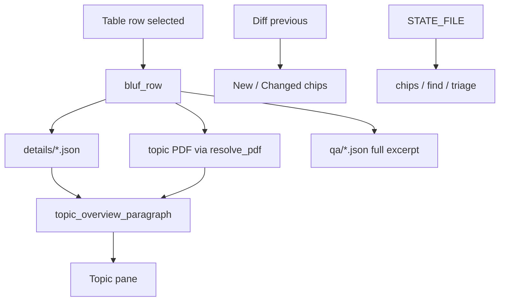

# ADR 009 — Hygiene, Do Next, and extractive topic overviews

**Status:** accepted  
**Date:** 2026-10-30  
**Depends on:** [003](003-competitive-local-catalog.md), [005](005-multi-source-modes.md),
[007](007-topic-qa-and-component-chips.md), [008](008-how-sbir-works-tab.md)

## Context

The Discovery sprint left a Do Next list (details JSON, New/Changed
chips, live due-in, persist chips/Find, instruction PDF, full Q&A, keyboard
hygiene) and a request for an “AI-generated paragraph” when a table row is
clicked. A separate question asked whether [navysbir.com](https://www.navysbir.com/)
must be scraped for the FY27 calendar.

Standing vetoes still apply: no cloud LLM, no DSIP `searchText`, no public
unsigned `.exe`, no CRM, no login/ask-Q&A.

## Decision

1. **navysbir.com is a citation only.** Ship a dated FY27 calendar snapshot
   in `sbir_guide.py`. Confirm live dates on DSIP. Never fetch or parse that
   site.
2. **Topic overview is extractive and local.** `topic_overview_paragraph`
   takes the first real objective/description sentences from on-disk
   `/details` JSON and/or the topic PDF, after stripping ITAR boilerplate.
   No HuggingFace, no OpenAI, no network at click time. A later optional
   local model is recorded in [010](010-optional-local-llms.md), not landed.
3. **Fetch public `/topics/{id}/details`** after Q&A. Stamp keywords,
   technology areas, and ITAR onto the manifest. Invalid ids refuse before
   `open_url` (same rule as Q&A).
4. **Hygiene:** wrap the toolbar onto a second row; keep table selection and
   `yview` across `_render_table` / `item_done`; document `STATE_FILE` as
   machine-local; isolate the conda Tk `scale.tcl` flake in the GUI download
   test.
5. **Do Next chips and keys:** ITAR / New / Changed; chip counts; hide empty
   Component chips after a snapshot exists; persist chips, Find, call filter,
   and tech-area in `STATE_FILE`; Ctrl+F focuses Find; Ctrl+B copies the
   brief; `1`/`2`/`3` stay table-only; Open instruction PDF uses `resolve_pdf`.
6. **User README vs architecture README.** `README.md` is how to run the
   tool. `CURRENT_ARCHITECTURE_README.md` holds diagrams and notes.

## Why

Capture work needs the extra DSIP fields and a one-paragraph brief without
turning the app into a chatbot or a scraper. Calendar dates go stale; a
labeled snapshot plus a link is enough.

## Architecture

## Tradeoffs

| Pros | Cons |
| --- | --- |
| Overview works offline in the exe | Extractive text can be choppy |
| Details enrich chips without a login | Extra public GETs per topic |
| Calendar visible next to the table | Snapshot dates go stale |

## Counter-adversarial review

| ID | Objection | Verdict |
| --- | --- | --- |
| A56 | Call a cloud model for the overview | **Rejected** |
| A57 | Scrape navysbir.com each launch | **Rejected** |
| A58 | Invalid details `topicId` hits DSIP | **Fixed** |
| A59 | Details/Q&A JSON traversal | **Fixed** |
| A60 | Write chips into `manifest.json` | **Rejected** |
| A61 | New/Changed empty before a diff | **Accepted** |
| A62 | Hide-zero chips on an empty first launch | **Fixed** |

## Residual risks

- `/details` can change shape; save is best-effort.
- New/Changed is vs the folder the user picked, not a cloud timeline.
- The FY27 table is not an official announcement.

## Consequences

Tests cover details id refusal, JSON sandboxing, extractive overview, chip
persist, New/Changed filters, selection preserve, and the navysbir “never
scrape” string in the guide. See
[implementation-recommendations.md](../implementation-recommendations.md).
