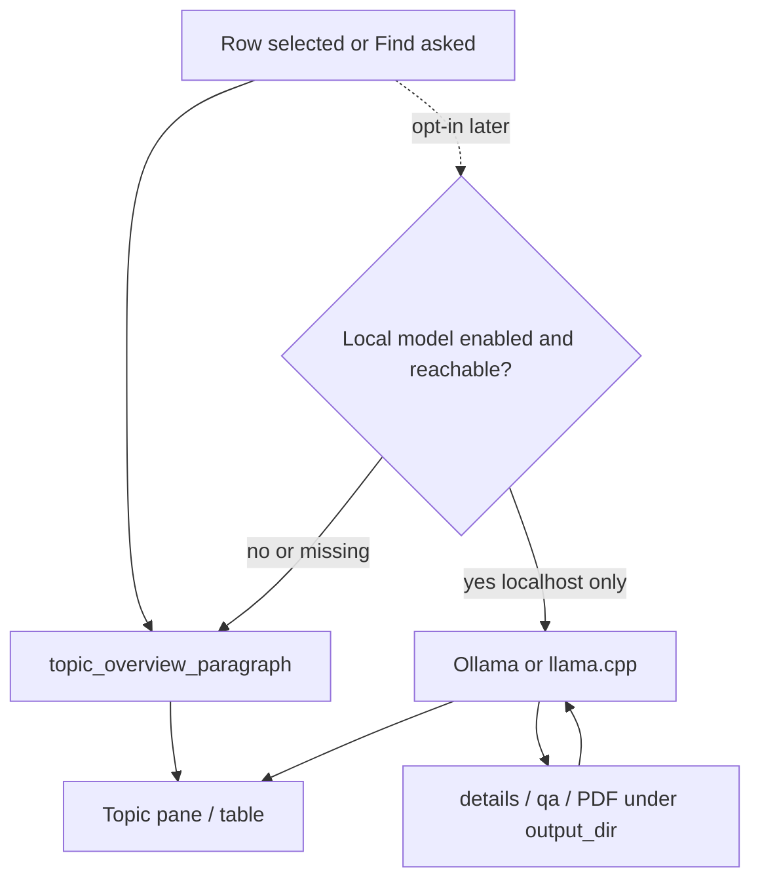

# ADR 010 — Optional local open-source LLMs (future, not landed)

**Status:** accepted (documentation only — no model client landed)  
**Date:** 2026-10-30  
**Depends on:** [003](003-competitive-local-catalog.md),
[009](009-hygiene-and-donext.md)  
**Does not authorize** shipping a model, an Ollama installer, or a HuggingFace
download in this repo.

## Context

The Topic pane overview is an **extractive** paragraph from on-disk
`details/*.json` and the topic PDF (`topic_overview_paragraph`). That is the
right default: DSIP already publishes the objective and description. The first
implementation echoed the title because it treated an ITAR-prefixed
`objective` field as empty.

A capture lead still asked whether an open-source model could *query* or
rewrite that text (better overview, “which of these 28 topics mention Zero
Trust in Q&A,” natural-language Find). Cloud APIs and HuggingFace-as-a-service
remain vetoed. Local runtimes exist that never send topic text off-box.

## Decision

**Today:** keep extractive BLUF / overview. Strip ITAR boilerplate, prefer
`/details` objective + description, fall back to PDF OBJECTIVE / DESCRIPTION,
truncate on a sentence boundary. No neural net at click time.

**Later, only if named, an optional on-box model** may be added for
*querying and rewriting text already on disk*. Allowed shapes:

| Runtime | What it is | Verdict |
| --- | --- | --- |
| **Ollama** (user-installed) + Llama 3.2 / Qwen 2.5 / Phi / Gemma | Local HTTP on `localhost`, weights stay on the machine | **Later**, opt-in |
| **llama.cpp** / a GGUF file the user already has | Same idea, no Ollama daemon | **Later**, opt-in |
| HuggingFace `transformers` pulled in as a runtime dep | Downloads weights, GPU stack, exe bloat | **No** |
| OpenAI / Gemini / Anthropic / any hosted API | Topic text leaves the box | **Never** |

Rules if that slice is ever requested:

1. **Off by default.** Extractive overview and alias Find stay the path that
   works with no extra install.
2. **Localhost only.** No remote Ollama host, no HF hub call at runtime.
3. **Snapshot text only.** Prompt context is `details/*.json`, `qa/*.json`,
   and PDF text already under `output_dir`. Never POST the catalog to a vendor.
4. **Fallback.** If the daemon is down or the model is missing, show the
   extractive paragraph and say so. Do not block Download or the table.
5. **Not in the unsigned `.exe`.** Do not bundle a multi-GB GGUF in
   `DSIP_Downloader.exe`. The packaged app stays extractive.
6. This ADR is **not** a green light to land `ollama` / `llama-cpp-python`
   until a later request names the runtime and accepts the tradeoffs.

Intended uses if landed: rewrite the Topic overview, answer a question about
the **current snapshot** (“topics with published Q&A about ASME Y14.5”), not
a general chatbot and not a CRM copilot.

## Why

The semantic content is already in the details JSON. A local 3B–7B model can
help *ask* that corpus in English. A cloud model would turn this appliance
into another HigherGov credit meter and break Discovery's local-only scope.

## Architecture

No arrow leaves the machine.

## Tradeoffs

| Pros | Cons |
| --- | --- |
| Query quality without a seat license | User must install Ollama or a GGUF |
| Topic text stays on-box | 3B–7B models still hallucinate citations |
| Extractive path stays fast and testable | Not shippable inside the portable exe |
| Honest fallback if the daemon is down | Another settings surface to misuse |

## Counter-adversarial review

| ID | Objection | Verdict |
| --- | --- | --- |
| A56 | Call a cloud model for the overview | **Rejected** — restated |
| A63 | Ship HuggingFace `transformers` + auto-download | **Rejected** |
| A64 | Default-on Ollama so “AI” always runs | **Rejected** — opt-in later |
| A65 | Bundle a GGUF in the PyInstaller exe | **Rejected** |
| A66 | Point Ollama at a LAN/remote host | **Rejected** — localhost only |
| A67 | Use the model as a keep/drop filter instead of aliases | **Rejected** — [001](001-search-aliases.md) stays deterministic |

## Residual risks

- A local model can still invent a dollar figure or a close date. UI copy
  must say it is a rewrite of local text, not an official DSIP quote.
- Users with no GPU will see slow first-token times; that is why extractive
  remains the default.

## Consequences

No code change is required to accept this ADR. The overview fix in
`analyze.topic_overview_paragraph` / `gui._refresh_detail` is extractive only.
A future slice adds a client behind a checkbox and tests that (a) a down
daemon falls back and (b) no URL other than `127.0.0.1` is opened.

See [implementation-recommendations.md](../implementation-recommendations.md).
