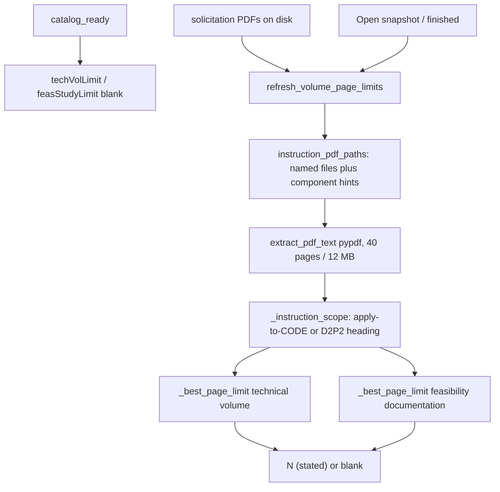

# ADR 011 — Extractive tech-vol and feasibility page limits

**Status:** accepted  
**Date:** 2026-11-03  
**Depends on:** [003](003-competitive-local-catalog.md), [004](004-adversarial-review.md),
[009](009-hygiene-and-donext.md)

## Context

Capture work needs the **Technical Volume** and **Phase I-equivalent
feasibility documentation** page caps before a proposal outline. Those numbers
live in component instruction PDFs (and sometimes the DoW BAA preface), not in
the DSIP catalog JSON. A first pass filled DoW “typical” ceilings
(Phase I tech 5, Direct to Phase II tech 15, D2P2 feasibility 5). That labeled
OSD / DRPM UxS `OSW27BZ01-DV002` as **15 (typical Direct to Phase II)** when
the component instructions state **five (5) pages** for both volumes.

The user manually verified that topic. The GUI still showed typicals, then
blanks, until the extractor, the file picker, and the `pypdf` backend were
fixed.

## Decision

1. **Extractive only.** Read local instruction / preface PDFs under
   `output_dir` via `resolve_pdf`. Quote a number only when the text states it.
   Label quoted values `N (stated)`.
2. **Never fill a typical page cap.** If the PDFs are silent, the table cell
   and Topic pane field are **blank**. Phase I feasibility is `n/a` because
   that volume does not apply. DoW typical *dollar* ceilings for Funding may
   still appear; they are a different field.
3. **Scope combined instruction books.** One PDF can hold Phase I (e.g. NV001
   “two (2) pages”) and D2P2 (DV002 “five (5) pages”). Prefer the longest
   “guidelines in this section apply to topic CODE” slice; otherwise cut at
   the Direct to Phase II heading.
4. **Parse OSD spelling.** Accept `five (5) pages`, `(5 page Maximum)`,
   `5-page Technical Volume`, and `15 pages`.
5. **This topic’s files only.** Use the row’s `instructionPdfs` plus filename
   hints (`OSW` / `DRPM` for OSD, `NAVY` for Navy, `DAF` for USAF). Do not
   concatenate every PDF in `solicitation_documents/`.
6. **Refresh when files exist.** Catalog rows start blank. After the
   solicitation-PDF phase, and again on snapshot load, recompute limits.
   `manifest.json` may still store empty strings from a run that lacked
   `pypdf`; the GUI overwrites the table from disk.
7. **`pypdf` is required for this column.** `python gui.py` from conda `base`
   had no `pypdf`, so every cell stayed empty. The GUI calls
   `ensure_pypdf(install=True)` at startup. Tests use `test/fixtures/OSW-DRPM_SBIR_27BZ_R1.pdf`.

User-facing extract notes:
[PAGE_LIMIT_EXTRACTION_README.md](../PAGE_LIMIT_EXTRACTION_README.md).

## Why

A wrong 15-page D2P2 cap wastes outline time. A silent typical 15 is worse
than a blank: it looks like a quote from *this* BAA. OSD/DRPM writes the cap
in words. The same PDF’s Phase I topic must not leak into D2P2.

## Architecture

Truth benchmark (user-verified): **OSW27BZ01-DV002** → tech **5 (stated)**,
feasibility **5 (stated)**. Same PDF, **OSW27BZ01-NV001** Phase I → tech
**2 (stated)**, feasibility **n/a**.

## Tradeoffs

| Pros | Cons |
| --- | --- |
| Blank cannot be mistaken for a BAA quote | Topics whose instructions never say a number look “missing” |
| OSD five-page D2P2 is visible | Extractor can still miss an unusual phrasing |
| Combined Phase I / D2P2 PDFs are scoped | Cover-sheet teasers must be ignored by length |
| GUI works from conda `base` after pypdf install | First launch may `pip install pypdf` (network) |

Rejected alternatives: typical DoW 15/5 fill; concatenating every component
PDF; cloud LLM “read the BAA”; scraping DSIP HTML instead of the upload PDF.

## Counter-adversarial review

| ID | Objection | Verdict |
| --- | --- | --- |
| A69 | Typical 15 on OSD DV002 | **Fixed** — stated 5/5; no typical fill |
| A70 | Spelled `five (5) pages` missed | **Fixed** — word + parenthetical + digits |
| A71 | NV001 two-page rule leaks into DV002 | **Fixed** — topic-code / D2P2 heading scope |
| A72 | All `solicitation_documents/*.pdf` concatenated | **Fixed** — named files + component hints |
| A73 | Cached `manifest.json` bluf stays empty | **Fixed** — recompute on load and after solicitation PDFs |
| A74 | conda `base` `python gui.py` has no pypdf | **Fixed** — `ensure_pypdf(install=True)` |
| A75 | Auto-`pip install pypdf` is a supply-chain step | **Accepted** — same library as `requirements.txt`; no other package |
| A76 | Table headers truncated so the column looks unused | **Fixed** — wider min width |
| A77 | Army CSO rows blank | **Accepted** — no stated cap in those instructions is a blank, not 15 |
| A78 | Write typicals back so the table is never empty | **Rejected** — user forbade typical fill |
| A79 | LLM read of the BAA | **Rejected** — extractive only |

Residual: `manifest.json` on disk may still list empty page-limit strings
until a GUI/CLI pass with `pypdf` recomputes them. Open snapshot to refresh.
Scanned image-only instruction PDFs cannot be read.

## Consequences

`test/test_analyze.py` encodes DV002 5/5, NV001 2, silent → blank, preface 15
must not override OSD 5. `test/test_gui.py` encodes columns and “fill after
solicitation PDFs.” New BAA phrasing gets a fixture + test, not a typical.
