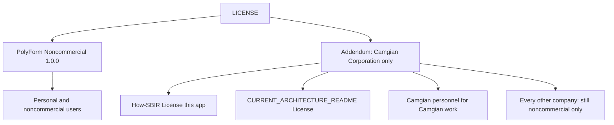

# ADR 012 — Camgian-only commercial carve-out

**Status:** accepted  
**Date:** 2026-11-09

## Context

Discovery is licensed [PolyForm Noncommercial 1.0.0](../../LICENSE) so
random companies cannot run it as a commercial BD seat. The copyright holder
asked for **one** named exception: Camgian Corporation
([camgian.com](https://www.camgian.com/)) may use the tool for its own
commercial work. No other company should get that right.

Camgian is identified as:

- Legal name: Camgian Corporation
- Leadership (identification only): Gary Butler
- CAGE: **4NP29**
- SAM UEI: **SPDKB76QMK48** (alternate listing **HVLBJJBVSUP7**)

This is not an MIT relicensing and not a public commercial license.

## Decision

1. Keep PolyForm Noncommercial 1.0.0 as the terms for everyone else.
2. Add a **LICENSE addendum** that grants Camgian Corporation only the right
   to use, copy, modify, and internally share the software for Camgian’s own
   commercial purposes (including internal BD / capture).
3. Forbid sublicense, resale, and use on behalf of another company.
4. Surface the same facts in architecture and in the GUI:
   - [CURRENT_ARCHITECTURE_README.md](../../CURRENT_ARCHITECTURE_README.md)
     **License** section
   - How-SBIR tab section **License (this app)** (`sbir_guide.py`)
   - README / Windows no-admin / CASE_STUDY one-liners
   - Catalog header still says PolyForm NC

## Why

A named addendum leaves PolyForm intact for the public. Putting the names
(CAGE / UEI / site) in LICENSE and in the How-SBIR tab makes the carve-out
auditable inside the running app, not only on GitHub.

## Architecture

## Tradeoffs

| Pros | Cons |
| --- | --- |
| One company can use it for paid BD without opening the license | LICENSE is no longer stock PolyForm-only |
| CAGE / UEI pins the legal entity | Alternate UEI listings can confuse SAM lookups |
| No sublicense keeps primes/teammates out | Camgian still cannot ship this as a product to a customer |

## Counter-adversarial review

- **Objection:** An “except Camgian” line is a general commercial license.
  **Fix:** Grant is personal to Camgian Corporation; sublicense and “on
  behalf of another company” are explicit no.
- **Objection:** Camgian partners (e.g. a prime) will claim the carve-out.
  **Fix:** “No other company” / no teammates / no customers in LICENSE.
- **Objection:** Putting camgian.com in the GUI looks like an endorsement.
  **Accepted residual:** identification of the licensee, not a partnership
  claim. How-SBIR already lists other https links.
- **Objection:** Dual-license the whole repo MIT for Camgian and PolyForm
  for others. **Rejected:** MIT would let Camgian redistribute under MIT
  terms to anyone. Addendum is use/internal-share only.

## Consequences

Commercial use by any firm other than Camgian Corporation remains outside
the license. Downloaded DSIP files stay U.S. Government works. A later
carve-out for a second company needs a new written addendum, not a silent
README edit.
